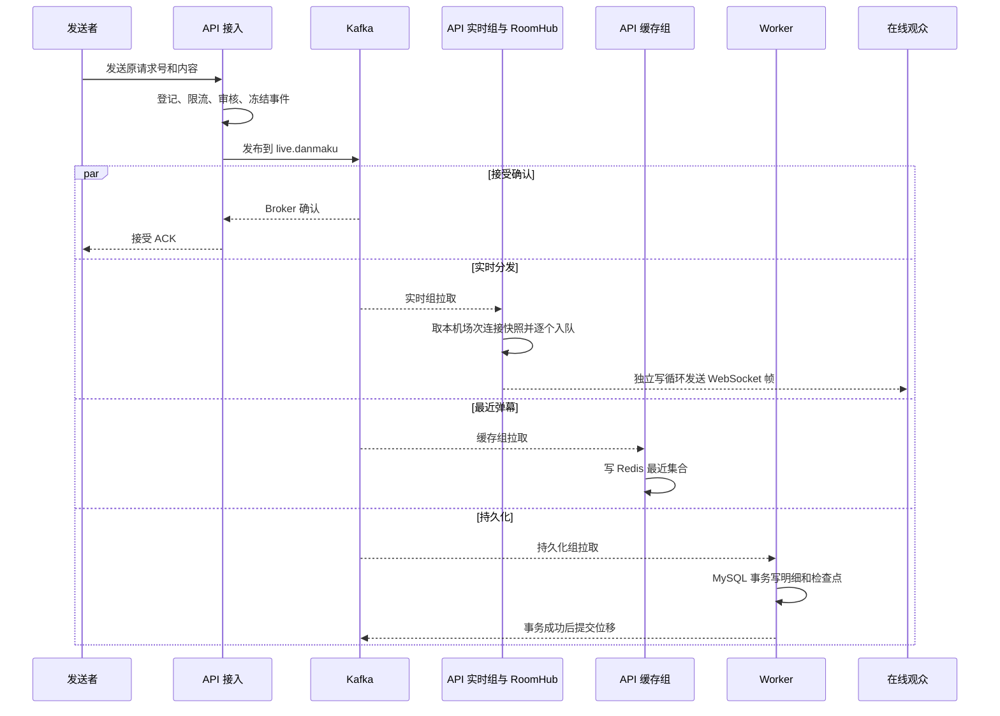
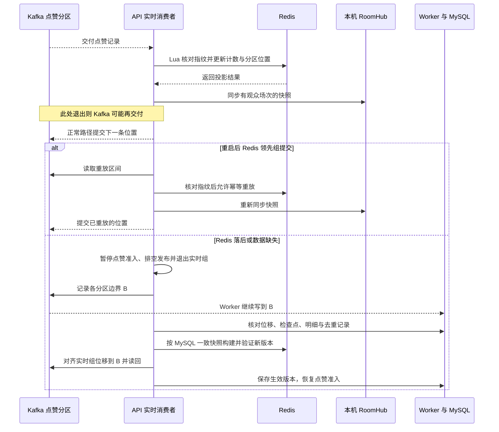

# 项目面试简介

## 一分钟项目介绍

> 我做的是一个 Go 直播间互动系统。用户可以注册登录、创建直播间、结束和重新开播。进入直播间后可以发弹幕、点赞、查看本场榜单和在线人数。页面用静态封面演示直播画面。
>
> 后端采用模块化单体，运行时有 API 和 Worker 两个进程。API 用 Hertz 提供 HTTP 接口，通过 WebSocket 处理实时互动。弹幕经过 AC 自动机审核后进入 Kafka，点赞在前端聚合后进入另一个 Topic。API 内的消费者负责实时处理和推送，Worker 负责把事件写入 MySQL。
>
> 项目里我重点处理了两个一致性问题。第一，同一账号打开两个窗口时，新窗口成功进房后接管旧窗口，在线人数也要算对。第二，点赞已经写进 Redis、但 Kafka 位移还没提交时，重放不能多算。Redis 数据回退时，则要核对 Kafka 和 MySQL 的进度，再恢复计数。

## 项目分析

项目围绕两条业务规则展开。弹幕只有通过审核才能公开展示。点赞即使经历重试、换窗、关播或 Redis 重启，也必须计入正确的账号与场次。房间长期存在，每次开播有独立的 `session_id`。对弹幕要保留内容与发送顺序，对点赞可以合并多次点击，这决定了两条不同的数据链。

本次核对的业务代码基线为 `8bb4d5a`，包含单账号观看归属与本机人数。下文引用的历史实验分别注明其版本或专项报告。

### 从哪几个入口读源码

| 入口 | 沿代码能追到什么 | 这样划分的理由 |
| --- | --- | --- |
| Vue 房间页 | 页面协调进房、一个共享 WebSocket、弹幕列表、点赞批次与榜单。见[房间页](../frontend/src/pages/RoomDetailPage.vue)、[连接状态](../frontend/src/realtime.ts)。 | HTTP 适合身份、查询和取基线，长连接适合互动和推送。连接重建后要重新取得首屏。 |
| API | Hertz 接 HTTP，Gorilla 经 adaptor 升级连接。Handler 做接入，Service 定业务判断，Repository 执行 SQL。见[API 入口](../backend/cmd/api/main.go)、[实时路由](../backend/internal/httpserver/realtime.go)。 | 房间归属、输入校验、WebSocket 写循环和数据库事务分别有明确负责人。 |
| API 内的实时消费者 | 点赞写 Redis 再同步本机快照。弹幕实时组分发，另一个缓存组维护最近弹幕。见[点赞组装](../backend/cmd/api/likes.go)、[弹幕组装](../backend/cmd/api/danmaku.go)。 | API 持有本机 Socket。广播、缓存刷新和持久化可以各自推进。 |
| Worker | 消费两类事件，核对身份、写明细与检查点，事务成功再提交 Kafka 位移。见[Worker 入口](../backend/cmd/worker/main.go)、[点赞事务](../backend/internal/likes/persistence.go)、[弹幕事务](../backend/internal/danmaku/persistence.go)。 | 将持久化时延移出实时广播路径，故障恢复要面对事务提交与 Kafka 提交之间的窗口。 |
| 迁移与依赖 | MySQL 8.4.13 用 InnoDB 保存业务历史，GORM 使用底层连接池。Redis 7.4.7 承担短原子操作。Kafka 4.0.0 提供分区日志。见[迁移入口](../backend/cmd/migrate/main.go)、[Go 依赖](../backend/go.mod)、[Compose](../deployments/docker/compose.yaml)。 | 当前一个 Go Module，API 与 Worker 分别启动。Compose 提供本地中间件，两类 Topic 各 16 分区、单副本。 |

### 面试时怎样讲各项业务

| 从用户操作出发 | 正常流程 | 最值得补充的一句话 |
| --- | --- | --- |
| 注册、登录和刷新 | 用户名归一化 → Argon2id 存密码 → 登录签 JWT → 刷新时调用 `/users/me`。 | 并发重名由唯一键裁决，密码派生有并发上限。[认证实现](../backend/internal/user/service.go) |
| 创建、关播和重开 | 建房及首场同一事务创建。关播或重开锁住房间行再改场次。 | 已获准的旧事件仍归旧场，新场从自己的编号开始统计。[房间事务](../backend/internal/room/repository.go) |
| 进房、换窗和人数 | Bearer 换一次性票 → 升级连接 → Redis 登记当前观看 → RoomHub 替换成员 → `ROOM_STATE`。 | 登录身份、观看编号和物理连接编号各有生命周期。同房换窗人数保持 1。[接管专项](interview-ws-presence.md) |
| 发弹幕 | 客户端队首 → 绑定请求、限流 → AC 审核并冻结 → Kafka 接受 → 分别广播、更新最近缓存、落库。 | 发送者同房有序，其他发送者之间无全房顺序承诺。审核拒绝只提示发送者。[提交服务](../backend/internal/danmaku/service.go) |
| 点赞和看榜 | 前端 500 毫秒聚合 → 发布冻结批次 → Redis 原子去重和计数 → 本机合并推送。Worker 独立落库。 | 一个事件可以代表多次点击，对账要按 `SUM(click_count)`。榜单范围是本场前一百。[点赞脚本](../backend/internal/likes/lua/project_like.lua) |
| 新观众看历史 | 实时帧与 Redis 最近列表按事件号合并。历史查询接口另可按游标读 MySQL。 | 新观众可能读到尚未入库的消息，也可能因为缓存消费延迟暂时看不到。[近期分页](../backend/internal/danmaku/recent.go)、[页面合并](../frontend/src/danmaku.ts) |

### 两段最常被要求现场画出的时序

**一条审核通过的弹幕。** 三个组各读一份日志。图中并行分支没有完成顺序，发送者收到 ACK 和观众收到广播的先后也没有保证。[弹幕接受](../backend/internal/danmaku/service.go)、[实时与缓存](../backend/cmd/api/danmaku.go)、[持久化](../backend/cmd/worker/main.go)

**一次点赞在哪个故障窗口会重放。** 下图使用同一分区的“下一条位置”。正常 Redis 重启若通过数据与进度核验，就沿用原投影。图的后半段只展开两种进度不一致的情形。[正常核验](../backend/internal/likes/initializer.go)、[重放核对](../backend/internal/likes/kafka_consumer.go#L276)、[完整重建](../backend/internal/likes/recovery.go#L132)

### 哪些结论有证据

| 口径 | 可以在面试中说什么 | 不能从该证据推出什么 |
| --- | --- | --- |
| 已实现，有专项验收 | 单 API 的真实双窗口验证了同房保持 1 人、跨房转移和失败握手保留旧连接。隔离环境实际回退过点赞 AOF，恢复后原请求重试、计数维持 12。[归属报告](verification/reports/ws-presence.md)、[点赞报告](verification/reports/like-recovery.md#实际结果) | 完整的多 API 广播、全局人数，以及恢复过程中第二次掉电后的自动接管。 |
| 从源码可以定位 | 每场一次广播随观众数线性增加入队次数。近期集合每次插入可能扫描已有 JSON 成员。每个 MySQL 池有上限。[分发代码](../backend/internal/realtime/danmaku_delivery.go)、[缓存脚本](../backend/internal/danmaku/lua/recent_add.lua)、[连接池](../backend/internal/database/mysql.go) | 当前瓶颈必在某一处，或扩大队列就能提升持续吞吐。 |
| 已知风险与规划 | 同一点赞请求改次数可能先收到 Kafka 接受确认，之后阻断投影。跨 API 业务分发、全局人数和小时级容量仍待补。[投影冲突](../backend/internal/likes/projection.go)、[当前待解决问题](status.md#待解决问题) | 点赞坏消息已自动隔离、支持万人热房或具有生产容量结论。 |

### 题库怎么用

校招练习先用一分钟讲完业务，再从一个具体用户操作走到第二个故障点。社招练习再补上不变量、替代方案、测量口径和证据边界。每张卡的追问与答案按相同序号对应，可以先遮住答案口述。**已实现**表示有对应实现，**代码可验证**表示可从给出的代码推出，**设计规划**表示备选改造或验证方法，**尚未实现**表示当前没有交付。

共 8 个维度、56 道主问题、209 道逐层追问。时间有限可从[优先准备的 30 题](#top30)开始。

| 维度 | 题号 | 维度 | 题号 |
| --- | --- | --- | --- |
| [项目基础与整体架构](#d1) | 001–006 | [数据库与缓存](#d5) | 031–038 |
| [技术选型与底层原理](#d2) | 007–013 | [分布式与系统设计](#d6) | 039–045 |
| [核心业务实现](#d3) | 014–023 | [故障排查与项目优化](#d7) | 046–051 |
| [并发与高性能](#d4) | 024–030 | [深度追问与开放性设计](#d8) | 052–056 |

[最容易被质疑的 20 题](#challenge) · [最能体现技术含量的 20 题](#highlights) · [底层原理](#principles) · [缺陷与风险](#risks) · [优先准备的 30 题](#top30)

## 一、项目基础与整体架构

### 问题编号：001　业务目标与验收范围

**面试问题：** 你交付了直播间里的哪一段体验，用什么结果证明它工作了？

**考察知识点：**

- 直播互动
- 业务不变量
- 验收口径

**问题来源：** [房间页面](../frontend/src/pages/RoomDetailPage.vue) · [真实连接验收](verification/reports/ws-presence.md) · [点赞恢复实验](verification/reports/like-recovery.md)

**考察目的：** 看候选人能否从用户操作讲到可观察的结果，并交代验证环境。

**追问链：**

1. 观众连点五下，什么结果才算正确？
2. 同一账号又开一个窗口，如何从观众视角验收？
3. 这两项验证能支持怎样的规模结论？

**回答需要覆盖的核心内容：**

查看口述示例与逐层回答

用户进入一场直播后可以发经过审核的弹幕、批量点赞、看本场榜单和在线人数。页面采用静态封面，后端负责互动。

1. 同一批的五次点击计入本场总数和本人累计。丢了确认再发原批次，总数仍只增加五。
2. 同房替换后仍显示一人，旧页退出互动，登录保留。切到另一房时，两房人数一减一加。
3. 它们证明指定故障和操作下的功能结果。稳定容量还要说明并发人数、发送率、热房比例、耗时和错误率。

**回答深度：** 基础

**真实性标记：** 已实现。双窗口和点赞恢复有隔离环境报告，容量另行测量。

### 问题编号：002　模块化单体与两个进程

**面试问题：** 为什么在一个 Go Module 里分别启动 API 和 Worker？

**考察知识点：**

- 模块化单体
- 进程边界
- 同步与异步通信

**问题来源：** [API 组装](../backend/cmd/api/main.go) · [Worker 消费循环](../backend/cmd/worker/main.go) · [部署拓扑](../deployments/docker/compose.yaml)

**考察目的：** 检验进程划分是否来自响应时延和持久化需求。

**追问链：**

1. 为什么注册和创建房间仍同步写 MySQL？
2. 为什么弹幕广播和落库各用一个组？
3. 只停 Worker，已经发布的事件怎么办？
4. 以后什么证据能支持继续拆服务？

**回答需要覆盖的核心内容：**

查看口述示例与逐层回答

API 持有真实 WebSocket，处理准入、发布及实时分发。Worker 独立消费并落库，两者共享业务事件定义，通过 Kafka 交接互动事件。

1. 调用者马上需要账号唯一性或新场次结果。数据库事务可以直接给出成功与失败。
2. 两项工作各自需要收到同一事件并维护进度。共享一个组的成员只会分摊分区。
3. 在日志保留范围内排队，恢复后按检查点继续。若整套 MySQL 不可用，API 的场次校验也受影响。
4. 先定位哪个模块需要独立扩容或独立故障域，再衡量跨进程通信、部署和一致性成本。

**回答深度：** 基础

**真实性标记：** 已实现。当前按单 API、独立 Worker 部署和验证。

### 问题编号：003　接受、广播与落库

**面试问题：** 用户看到“已接受”时，广播、缓存和数据库已经走到哪一步？

**考察知识点：**

- Broker 确认
- 独立订阅
- 端到端观察点

**问题来源：** [弹幕发布确认](../backend/internal/danmaku/service.go#L191) · [广播与缓存组](../backend/cmd/api/danmaku.go) · [Worker 落库](../backend/internal/danmaku/persistence.go#L64)

**考察目的：** 看候选人能否给成功定义边界，并解释三个不同时间点。

**追问链：**

1. 广播可能早于发送者看到 ACK 吗？
2. 发送者有 ACK，新观众也从 Redis 查到了，能证明落库吗？
3. 实时组已经给连接入队，能证明观众看见了吗？

**回答需要覆盖的核心内容：**

查看口述示例与逐层回答

首次发布成功时，接受 ACK 证明 Kafka 已接收事件。实时组、缓存组和持久化组各自消费。浏览器收到 ACK 的时刻不能用来推断这三个组的进度。

1. 可以。Broker 已接受后，消费者与返回 ACK 的网络路径可同时推进。
2. 只能证明缓存组已经处理。要查 MySQL 对应事件或核对持久化检查点。
3. 写协程、网络、浏览器回调和绘制都在后面。需要客户端观测才能回答具体到哪一步。

**回答深度：** 基础

**真实性标记：** 已实现。各消费组异步运行，观察顺序取决于调度和负载。

### 问题编号：004　四种状态由谁管理

**面试问题：** Redis、MySQL、Kafka 和 Go 内存保存的状态各能回答什么问题？

**考察知识点：**

- 状态归属
- 可恢复性
- 资源生命周期

**问题来源：** [数据设计](design/database.md) · [场次观众对象](../backend/internal/realtime/audience.go) · [有效投影代次](../backend/internal/likes/persistence.go#L119)

**考察目的：** 考察是否能为每份数据说明权威来源和丢失后的恢复依据。

**追问链：**

1. 要向某个观众写消息，为什么 Redis 里的连接编号还不够？
2. API 重启后能从 MySQL 恢复在线人数吗？
3. Redis 中的总数缺了，可否把不存在直接解释成零？

**回答需要覆盖的核心内容：**

查看口述示例与逐层回答

MySQL 保存账号、场次、事件明细和数据库进度。Kafka 保存有保留期的日志。Redis 保存实时投影、最近弹幕、请求登记和观看归属。Go 内存持有连接与本机快照。

1. Socket 属于建立连接的操作系统进程。编号帮助找到归属实例，实际写入要通过本地连接对象。
2. 当前人数来自本机有效连接，客户端重新入房才计入。数据库保留的是业务记录。
3. 只有已知新场次能初始化为零。历史场次缺数据要用事件明细、去重记录和分区位置核对。

**回答深度：** 基础

**真实性标记：** 代码可验证。不同数据的恢复保证由各自的所有者决定。

### 问题编号：005　房间与场次生命周期

**面试问题：** 主播在同一个房间开第二场，为什么还需要一个新的场次编号？

**考察知识点：**

- 领域建模
- 权限
- 生命周期与历史隔离

**问题来源：** [房间与场次事务](../backend/internal/room/repository.go#L48) · [房间领域模型](design/domain-model.md)

**考察目的：** 判断是否用正确的业务身份约束点赞、弹幕和迟到请求。

**追问链：**

1. 只用 room_id 统计榜单，重开会怎样？
2. 房主连续点两次重开呢？
3. 创建房间接口超时也能照此重试吗？

**回答需要覆盖的核心内容：**

查看口述示例与逐层回答

房间定义长期归属和标题，场次定义某一次直播。创建房间同时创建首场，重新开播分配新场次，房主身份来自经认证的账号。

1. 上一场的点击和迟到事件会混入新榜，无法独立核对每一场。
2. 事务读到已经开放时沿用当前场次。中间若发生关闭，下一次重开就代表新的业务操作。
3. 创建缺少 HTTP 请求幂等键。页面先刷新本人房间列表确认结果，避免重复建房。

**回答深度：** 基础

**真实性标记：** 已实现。创建、关闭、重开以及旧场隔离均有对应业务路径。

### 问题编号：006　普通就绪与业务可用性

**面试问题：** 为什么 API 的就绪探针成功，页面仍可能显示点赞恢复中？

**考察知识点：**

- 存活与就绪
- 能力降级
- 独立进程观测

**问题来源：** [HTTP 运维接口](design/api-spec.md#运维接口) · [点赞恢复状态机](../backend/cmd/api/likes.go#L54) · [Worker 指标](../backend/cmd/worker/metrics.go)

**考察目的：** 检验能否界定故障影响面，防止单项业务恢复时误判整个 API。

**追问链：**

1. 点赞正在重建，哪些操作可以继续？
2. 此时还允许 WebSocket 进房吗？
3. 如何发现 Worker 正在运行却没消化积压？

**回答需要覆盖的核心内容：**

查看口述示例与逐层回答

存活探针检查进程是否响应，就绪探针核对 HTTP 生命周期和 MySQL。点赞、弹幕有独立能力状态，Worker 需要查看自己的运行状态和进度。

1. 数据库正常时，登录、注册和房间读取可以继续。启用点赞时会暂缓改变场次集合的建房、关闭和重开。
2. 取决于场次和 Redis 归属能否确认。收到首屏后，各互动功能按各自的可用状态开放。
3. 结合进程指标、各分区已提交位置、数据库检查点和日志末端，观察一段时间内的推进速度。

**回答深度：** 中级

**真实性标记：** 已实现。探针、互动能力和 Worker 各有独立状态。

## 二、技术选型与底层原理

### 问题编号：007　Hertz 标准网络实现与适配器

**面试问题：** 项目为什么选 Hertz，为什么又选了标准库网络实现？

**考察知识点：**

- 请求链
- 传输层选择
- WebSocket 适配

**问题来源：** [服务组装](../backend/internal/httpserver/server.go#L47) · [WebSocket 路由](../backend/internal/httpserver/realtime.go#L20) · [依赖版本](../backend/go.mod)

**考察目的：** 区分框架能力、项目主动做的配置和实测性能。

**追问链：**

1. 一个 HTTP 请求怎么进入业务？
2. 为什么 WebSocket 要加适配层？
3. 换成标准库路由是否可行？
4. 如果说框架更快，面试官会要什么证据？

**回答需要覆盖的核心内容：**

查看口述示例与逐层回答

Hertz 接入路由、中间件和统一错误响应，Service 用普通 Go 接口。当前选择标准网络传输，启动监听失败能交给现有退出流程处理。

1. 请求经路由和适用的中间件完成追踪、认证及输入检查，Handler 调 Service，Repository 负责查询，响应由接入层映射。
2. Gorilla Upgrader 接收标准库 HTTP 接口，Hertz adaptor 把握手交给它，升级后的连接由实时模块独立管理。
3. 可以。主要迁移路由、认证中间件、错误映射和升级接入。业务服务及 SQL 事务已有框架边界。
4. 固定编解码、日志、连接数和请求内容，对照延迟分位、吞吐、分配与 CPU，再看热点是否真的落在 HTTP 接入层。

**回答深度：** 中级

**真实性标记：** 代码可验证。没有 Hertz 与其他框架的对照跑分。

### 问题编号：008　WebSocket 升级与帧

**面试问题：** WebSocket 维持长连接时，哪些行为由协议保证，哪些要业务补上？

**考察知识点：**

- HTTP Upgrade
- 消息帧
- 控制帧
- 关闭码

**问题来源：** [连接写循环](../backend/internal/realtime/delivery.go#L188) · [前端连接管理](../frontend/src/realtime.ts) · [RFC 6455](https://datatracker.ietf.org/doc/html/rfc6455) · [Gorilla 并发契约](https://pkg.go.dev/github.com/gorilla/websocket@v1.5.3)

**考察目的：** 看能否把协议、库的并发约束和可见业务状态连起来。

**追问链：**

1. 一次 TCP 读取恰好是一条弹幕吗？
2. 空闲窗口怎么知道对端仍可用？
3. 多个业务要推送，谁写 Socket？
4. 断线是否都该自动重连？

**回答需要覆盖的核心内容：**

查看口述示例与逐层回答

HTTP/1.1 握手成功后，客户端和服务端在同一 TCP 连接上交换帧。项目用应用消息区分首屏、发送确认和房间广播。

1. TCP 提供有序字节流。WebSocket 提供消息边界，一条消息可以分帧，应用读取完整消息后才解析 JSON，并限制消息大小。
2. 服务端约每 20 秒发 Ping，收到 Pong 会延长读截止时间，长时间收不到回应就清理。写也有超时。
3. 各业务投递到连接队列，由一个写循环串行写数据帧。一个读循环处理入站帧，符合 Gorilla 的一读一写约束。
4. 普通掉线按退避重试。收到被接管的关闭码 4009 就停止重连并提示用户，防止两个窗口反复争抢。

**回答深度：** 中级

**真实性标记：** 已实现。网络故障下的离线必达没有承诺。

### 问题编号：009　Go 调度与网络轮询

**面试问题：** 几万条连接如果都在等网络，Go 会开几万个操作系统线程吗？

**考察知识点：**

- G/M/P
- 网络轮询
- 可运行队列
- 容量验证

**问题来源：** [连接生命周期](../backend/internal/realtime/manager.go) · [实际写循环](../backend/internal/realtime/delivery.go#L188) · [Go 运行时说明](https://go.dev/src/runtime/HACKING) · [网络轮询实现](https://go.dev/src/runtime/netpoll.go)

**考察目的：** 检验能否从 I/O 等待进一步解释热房间 CPU 瓶颈。

**追问链：**

1. Socket 就绪后由谁唤醒？
2. 等待读写不独占线程，为什么连接数仍然要限？
3. 如何判断是调度等待还是广播程序算得慢？

**回答需要覆盖的核心内容：**

查看口述示例与逐层回答

Goroutine 是 Go 调度的执行单元，M 是系统线程，P 提供执行 Go 代码所需的调度资源。等待可轮询的网络 I/O 时，G 可以挂起，让线程处理其他就绪工作。

1. 标准库把可轮询的描述符接入运行时 netpoll。Linux 通常用 epoll 汇集就绪事件，运行时把等待的 G 放回可运行队列。
2. 每条连接仍占文件描述符、Socket 缓冲、Go 栈、发送队列和定时器。几万人同时变成可写时还会竞争 CPU 与带宽。
3. 看运行队列、执行跟踪、CPU profile 和实际扇出耗时，分别找可运行但未获调度的等待、序列化/循环耗时和网络写阻塞。

**回答深度：** 高级

**真实性标记：** 代码可验证。几万连接属于容量假设，缺少对应实测。

### 问题编号：010　Redis 事件循环与 I/O 线程

**面试问题：** Redis 在这个项目里为什么能快速做原子登记，启用 I/O 线程会改变什么？

**考察知识点：**

- 事件循环
- 就绪通知
- I/O 线程
- Lua 占用时间

**问题来源：** [弹幕登记脚本](../backend/internal/danmaku/lua/begin_request.lua) · [Redis 7.4.7 配置](https://raw.githubusercontent.com/redis/redis/7.4.7/redis.conf) · [事件循环源码](https://raw.githubusercontent.com/redis/redis/7.4.7/src/ae.c)

**考察目的：** 检验能否从底层执行模型解释同一实例上热点脚本的代价。

**追问链：**

1. Linux 下 epoll 做了哪一部分工作？
2. Redis 7.4 的网络 I/O 线程负责什么？
3. 这解释了最近弹幕缓存的哪种风险？
4. 怎么证明值得改脚本？

**回答需要覆盖的核心内容：**

查看口述示例与逐层回答

常用数据驻留内存，多路复用让事件循环服务多个连接。登记脚本运行时，其他命令无法插入它的判断和更新之间。

1. 它报告哪些描述符准备好读写，减少逐连接轮询。具体的 Lua 判断、查表和 ZSET 更新仍要执行。
2. 默认配置 io-threads 为 1。启用额外线程可分担套接字写，按配置也可分担读取和协议解析，常规命令和 Lua 的数据操作仍在主执行线程上串行完成。
3. 每次写同一个场次的缓存都可能扫描现有成员、解 JSON。热场次脚本运行越久，同实例上连接续租、点赞等命令也要排队。
4. 固定写入率和成员数，记录客户端延迟与 Redis SLOWLOG、命令延迟分布，再对照减少扫描后的实现的耗时和额外内存。

**回答深度：** 高级

**真实性标记：** 代码可验证。Redis 工作线程的实际数量应从运行实例读取。

### 问题编号：011　GORM、连接池与 InnoDB

**面试问题：** GORM 后面有几个连接池，事务为什么必须一直使用同一个事务句柄？

**考察知识点：**

- database/sql
- InnoDB 事务
- 等待与超时

**问题来源：** [MySQL 打开与参数](../backend/internal/database/mysql.go) · [弹幕持久化事务](../backend/internal/danmaku/persistence.go) · [Go 连接池说明](https://go.dev/doc/database/manage-connections)

**考察目的：** 识别把 ORM、数据库连接与事务混成一个概念的问题。

**追问链：**

1. 事务内误用外层 db 会怎样？
2. 连接都借走时，新查询怎样？
3. 为什么不先把池调到 100？

**回答需要覆盖的核心内容：**

查看口述示例与逐层回答

每个进程各自打开数据库，GORM 复用其底层 sql.DB 池。代码为每个池设置最多 10 个打开连接、10 个空闲连接和 3 分钟最大生命周期。

1. 查询可能从池里借到另一条连接，离开原事务。业务明细和进度便可能分开提交。
2. 等空闲连接或上下文到期。长事务既占用连接，也可能延长数据库内的锁等待。
3. 总预算随 API、Worker 进程数相加。应先比较池等待、事务时长、MySQL 活跃线程和锁等待，小幅调参后复测。

**回答深度：** 中级

**真实性标记：** 代码可验证。最大连接数是配置值。

### 问题编号：012　Kafka 日志、ISR 与确认

**面试问题：** Kafka 返回 acks=all，单 Broker 下它究竟保护了什么？

**考察知识点：**

- 追加日志
- ISR
- 副本确认
- 保留期

**问题来源：** [生产者](../backend/internal/likes/kafka_producer.go) · [本地 Broker 与 Topic](../deployments/docker/compose.yaml) · [Kafka 4.0 设计](https://kafka.apache.org/40/design/design/)

**考察目的：** 考察能否准确划分消息可靠性和部署故障边界。

**追问链：**

1. 消息消费完为什么还能从较早位置读？
2. 两套消费组速度不同会互相挡住吗？
3. 部署成多 Broker 要同步改哪些条件？

**回答需要覆盖的核心内容：**

查看口述示例与逐层回答

生产者要求当时 ISR 中的副本确认。当前 Topic 复制因子为 1，ISR 里只有一个副本。收到 ACK 能证明 Broker 接受了记录，整块磁盘丢失仍可能损失已经确认的事件。

1. 日志按分区追加，消费者组保存下次读取的位置。数据保留期间，其他组或指定位置的读取器仍可读到原记录。
2. 它们各有位移，分别前进。慢组超过保留窗口后，所需的旧日志有可能已被清理。
3. 规划复制因子、min.insync.replicas、acks 以及可接受的写入失败，并演练副本故障。只多开 Broker 并不会自动给已有单副本分区增加副本。

**回答深度：** 中级

**真实性标记：** 代码可验证。本地单 Broker，跨机容灾属于设计规划。

### 问题编号：013　AC 失败指针与文本规范化

**面试问题：** 为什么用 AC 自动机做弹幕审核，它怎么在一次扫描里找到多个词？

**考察知识点：**

- Trie
- 失败指针
- 输出继承
- Unicode

**问题来源：** [词库构建与匹配](../backend/internal/danmaku/moderation.go) · [版本化本地词库](../backend/configs/moderation_words.tsv) · [审核验收](verification/reports/danmaku.md)

**考察目的：** 让候选人用实际匹配过程解释算法、输入边界和变更成本。

**追问链：**

1. 假设已有演示词 abc 和 bc，扫描 abc 会发生什么？
2. 用户原文需要直接改写吗？
3. 为什么重试不能重新按最新词库裁决？
4. 词库增长时如何验证替代选择？

**回答需要覆盖的核心内容：**

查看口述示例与逐层回答

启动时把词建成按 rune 遍历的 Trie，广度优先计算失败指针并继承匹配输出。同一份只读自动机可被多个请求使用。当前 TSV 含 80 条种子词、6 类，词库变更的版本随事件保存。

1. 到达 abc 节点时能同时读到该节点及其失败链继承的输出 bc。失配时沿失败指针退到已有前缀，输入指针继续前进。
2. 审核副本做 NFKC、小写化并去掉指定的两个零宽字符，业务保留原文。插入其他分隔符、谐音等仍有漏判可能。
3. 已审核通过的请求冻结内容、事件身份和审核版本。同一逻辑请求在网络重试后保持原裁决，用户改文案要用新请求号。
4. 构建成本与词库总长度相关，匹配看输入长度和输出数量。可以在真实文本分布上比较逐词查找和 AC 的构建内存、延迟分位、误判与漏判。

**回答深度：** 中级

**真实性标记：** 已实现。当前词库为随项目发布的 TSV 文件。

## 三、核心业务实现

### 问题编号：014　注册登录与密码计算限额

**面试问题：** 账号注册和登录怎样在安全与服务容量之间取舍？

**考察知识点：**

- Argon2id
- 随机盐
- 并发信号量
- JWT

**问题来源：** [密码与并发](../backend/internal/user/service.go) · [Argon2id](../backend/internal/user/password.go) · [用户名唯一错误](../backend/internal/user/repository.go) · [令牌验证](../backend/internal/user/token.go) · [登录恢复](../frontend/src/App.vue)

**考察目的：** 看能否同时解释密码存储、身份验证和计算资源成本。

**追问链：**

1. 相同密码为什么会有不同的存储结果？
2. 两个窗口同时注册同一用户名怎么办？
3. 大量登录同时到来为什么危险？
4. 用户不存在能立即返回吗？
5. JWT 怎样在之后的请求中生效？

**回答需要覆盖的核心内容：**

查看口述示例与逐层回答

注册时给每个密码生成随机盐，用 Argon2id 保存参数和派生结果。登录校验成功才签发短期 JWT。

1. 每次生成 16 字节随机盐。校验时从记录还原盐与参数，重新派生后比较。
2. 用户名先规范化，最终由数据库唯一键裁决，第二次插入命中唯一冲突后映射为用户名已占用。只在应用里先查一次会有竞态。
3. 当前单次派生配置约 19 MiB 内存和两轮计算，用容量为 4 的槽限制同进程密码计算并发，入口还按来源 IP 限频。
4. 登录对未知用户也执行虚拟密码校验并返回统一错误，使账号是否存在更难从响应区分，也要为该计算预留容量。
5. 服务端校验 令牌的 HS256 签名、签发者、接收者、用户标识和时间。刷新时前端从 localStorage 取令牌并调用 /users/me 恢复身份。退出会清凭据，已发令牌按 30 分钟有效期失效。

**回答深度：** 中级

**真实性标记：** 已实现。账号级撤销和刷新令牌尚未实现。

### 问题编号：015　并发关播重开及在途事件

**面试问题：** 关播、重开和最后一条弹幕同时发生，事件归哪一场？

**考察知识点：**

- 房间行锁
- 活动场次唯一性
- 在途边界

**问题来源：** [房间事务](../backend/internal/room/repository.go#L81) · [活动场次约束](../backend/migrations/000004_create_sessions_likes.go) · [弹幕准入](../backend/internal/danmaku/service.go#L64) · [点赞准入](../backend/internal/realtime/likes.go)

**考察目的：** 区分事务内的互斥与数据库、Kafka 之间的业务边界。

**追问链：**

1. 两个重开请求为什么不会各建一场？
2. 历史场次为什么不违反这个唯一约束？
3. 旧窗口在新场开始后重新发送呢？
4. 能承诺关播 HTTP 返回时所有旧事件都落库吗？

**回答需要覆盖的核心内容：**

查看口述示例与逐层回答

每次开播产生独立 session_id。消息通过准入时绑定场次，关播后迟到的已接受事件继续归原场。

1. 事务对房间行加 FOR UPDATE，检查拥有者及当前状态。同一房间的活动场次还有唯一约束做最后一道保护。
2. 生成列对活动场次取 room_id，对已结束场次取 NULL，MySQL 唯一索引允许多条 NULL。
3. 新业务要核对当前活动场次。能证明已接受的旧请求可返回旧结果，旧事件保留原场标识，不能搬到重开的场次。
4. 实时准入、Kafka 发布和 Worker 落库跨系统。要新增这种承诺，需设计关播边界与排空协议，并承担更长的关播等待。

**回答深度：** 高级

**真实性标记：** 已实现。关播时跨系统清空全部在途事件的屏障尚未实现。

### 问题编号：016　一次性票据与首屏

**面试问题：** 浏览器如何用登录身份建立一条属于指定场次的 WebSocket？

**考察知识点：**

- 一次性票据
- Origin
- 升级
- ROOM_STATE

**问题来源：** [签发路由](../backend/internal/httpserver/realtime.go#L70) · [票据仓](../backend/internal/realtime/ticket.go#L34) · [握手流程](../backend/internal/realtime/manager.go)

**考察目的：** 考察认证是否覆盖从 HTTP 到可互动状态的全过程。

**追问链：**

1. 两个握手同时拿同一张票怎么办？
2. HTTP 返回 101 就能发弹幕了吗？
3. 新窗口在升级或登记前失败会怎样？
4. 未来负载均衡把签票和升级分到不同节点呢？

**回答需要覆盖的核心内容：**

查看口述示例与逐层回答

前端先用 Bearer 换取短期房间票据，再用它握手。票据绑定身份、房间、场次、Origin 和到期边界，服务端只保留随机票据的摘要。

1. 消费在同一把锁里匹配并删除票据，最多成功一次。票据最长约 30 秒，且受访问令牌剩余有效期限制。
2. 还要取得 Redis 归属、加入本机 RoomHub，生成初始状态。前端收到 ROOM_STATE 才进入可用观看状态。
3. 释放预留的连接资源，原观看继续有效。登记调用超时须按本次 connection_id 查回结果，避免另发一次主动接管。
4. 进程内票据无法在另一节点消费，需设计会话路由或共享的一次性票据仓，并验证跨节点重连。

**回答深度：** 中级

**真实性标记：** 已实现。票据仓在签发 API 进程内。

### 问题编号：017　新窗口接管与人数

**面试问题：** 同一账号再开一个窗口，为什么旧页会退出而人数仍算对？

**考察知识点：**

- watch_id
- 连接代次
- 原子替换
- 在线人数

**问题来源：** [接管与人数](../backend/internal/realtime/presence.go#L58) · [原子登记](../backend/internal/realtime/lua/claim_owner.lua) · [双窗口验证](verification/reports/ws-presence.md)

**考察目的：** 验证是否真正处理了两个活连接重叠和旧清理迟到。

**追问链：**

1. Redis 具体存什么？
2. 旧连接迟到的关闭会误删新登记吗？
3. 同房换窗与从 A 切到 B 分别怎么计？
4. 旧页掉线时没收到被踢提示，会抢回来吗？

**回答需要覆盖的核心内容：**

查看口述示例与逐层回答

主动进入生成新的 watch_id，每次握手生成全局唯一 connection_id。Redis 确认后，在同一次 RoomHub 本地更新中替换成员，再推送首屏。

1. ws:owner:{user_id} 的值含 user_id、instance_id、connection_id、room_id、session_id、watch_id、generation、run_id 和 active。Socket 对象只存 Go 内存。
2. Redis 脚本核对运行实例、API 实例、连接 ID 和代次，RoomHub 清理也核对当前成员。键过期后代次可从 1 重来，唯一连接 ID 仍能区分新旧。
3. 同房间有效数维持 1，跨房本机 A 减 1、B 加 1。首屏带当前快照，变化合并推送并带人数版本。
4. 自动恢复必须提交旧 watch_id 并通过归属检查。被替换后恢复遭拒，旧页停止互动和自动重连，账号登录仍保留。

**回答深度：** 高级

**真实性标记：** 已实现。人数是本机有效观看数。

### 问题编号：018　弹幕审核冻结及结果未知

**面试问题：** 一条弹幕通过审核后 Kafka 响应超时，为什么页面要保留原请求？

**考察知识点：**

- 请求指纹
- 执行权
- 冻结事件
- 结果未知

**问题来源：** [提交状态机](../backend/internal/danmaku/service.go#L64) · [登记脚本](../backend/internal/danmaku/lua/begin_request.lua) · [条件变更](../backend/internal/danmaku/lua/change_request.lua) · [客户端队首](../frontend/src/danmaku.ts)

**考察目的：** 用一次超时贯穿准入、审核和跨系统幂等。

**追问链：**

1. 首次发送冻结哪些字段？
2. 两条请求用同一个编号却改内容呢？
3. 审核拒绝、发布结果未知、接受缓存回写失败分别回什么？
4. Redis 找不到记录就重做行吗？

**回答需要覆盖的核心内容：**

查看口述示例与逐层回答

超时可能发生在 Broker 写入之后。页面保存原请求号和内容，服务端据此找回已有裁决，或者重发同一个冻结事件。

1. 固定事件标识、原文、发送者用户名快照、审核版本与事件时间。V2 还固定首次冻结对应的服务端收到时间，重试复用这些值。
2. 服务端先比对请求指纹，场次或内容有差异即返回冲突。执行权初始租期 15 秒，冻结、拒绝和释放还要匹配执行者令牌。
3. 拒绝只提示修改，修改后建新请求。发布不确定时返回待核对。Broker 明确接受后即使 Redis 接受标记回写失败也可给 ACK，并记录指标。
4. 先核对 MySQL 已接受明细。Redis 身份变化后的保护期会阻止无法辨认的旧请求重新登记，避免把尚未落库的消息当成全新请求。当前身份变化触发的保守窗口是 5 分钟，仍无冻结记录与 SQL 结果的旧请求可能长期待核对。

**回答深度：** 高级

**真实性标记：** 已实现。Redis 记录丢失且 SQL 尚无证据时会保留不确定状态。

### 问题编号：019　同用户同房弹幕顺序

**面试问题：** 如何保证一个用户在同一间房发出的两条弹幕顺序正确？

**考察知识点：**

- 客户端 FIFO
- 分区键
- 分区内处理
- 顺序范围

**问题来源：** [发送队列](../frontend/src/danmaku.ts) · [Kafka 记录键](../backend/internal/danmaku/event.go) · [弹幕消费循环](../backend/internal/danmaku/kafka_consumer.go)

**考察目的：** 追问“有序”具体是对谁、哪一段链路以及怎样的客户端而言。

**追问链：**

1. 为什么按房间和用户组合，而不只按房间？
2. Kafka 能自动修复多个客户端任意并行发包的顺序吗？
3. 前一个请求确认丢了，后一条怎么办？
4. 所有观众看到整个房间完全一样的顺序吗？

**回答需要覆盖的核心内容：**

查看口述示例与逐层回答

页面维护最多 20 个待处理请求的队列，前一请求取得明确结果后才推进队首。Kafka 按 room_id:user_id 路由，同键在当前分区配置下进入同一分区。

1. 两个不同用户之间没有业务上的先后约束，组合键允许热房的不同发送者分布到多个分区。
2. 它只能记录到达同一分区的追加顺序。绕过当前队列的多个发送者若需统一序号，服务端要另设序列与缺口处理。
3. 队首约 3 秒未获确认就用原号重试，一轮最多 5 次，随后保留队首待核对。这样会牺牲该用户后续消息的即时性。
4. 不承诺。不同分区由不同消费路径带入本机扇出，断线观众还可能通过最近缓存补看。扩分区前也须处理键映射变化。

**回答深度：** 高级

**真实性标记：** 代码可验证。保证范围是正常客户端同用户同房的发送链。

### 问题编号：020　批量点赞与断线补发

**面试问题：** 点赞连点如何合并，弱网或点赞恢复时怎样补发？

**考察知识点：**

- 前端聚合
- 冻结批次
- 重试预算
- 场次隔离

**问题来源：** [前端批次管理](../frontend/src/likes.ts) · [服务端事件](../backend/internal/likes/event.go) · [点赞接入](../backend/internal/realtime/likes.go)

**考察目的：** 确认候选人能解释点击数、事件数、网络发送次数三个口径。

**追问链：**

1. 为什么不能给重试批次再加一赞？
2. 断网或后端恢复中，点击存哪？
3. 什么时候会停止自动发？
4. 浏览器关闭后能承诺永不丢吗？

**回答需要覆盖的核心内容：**

查看口述示例与逐层回答

首个点击打开 500 毫秒聚合窗口，发送前把次数和请求号冻结。新点击进下一批，超时重试原批。

1. 同一个请求号代表固定次数，改动会改变内容指纹。应把新增点击留给下一批。
2. 页面在本场已确认、可收集的观看状态继续累计，并按账号、房间和场次保存在 sessionStorage。最多 100 个冻结待确认批次，达到上限先保留可累计的点击。
3. 等待连接、能力或缓冲条件恢复后才发送。确认超时约 3 秒，每批同一轮连接最多尝试 5 次，过期和场次切换有单独处理。
4. 存储依赖浏览器会话、可用空间与 24 小时请求窗口。对账时还要把批次数和 SUM(click_count) 分开。

**回答深度：** 中级

**真实性标记：** 已实现。页面存储有生命周期和容量上限。

### 问题编号：021　前百名同分排序与大整数

**面试问题：** 本场点赞前一百名，如何在大整数和同分用户之间排对顺序？

**考察知识点：**

- ZSET 字典序
- 精度
- Top K
- 溢出边界

**问题来源：** [排序编码](../backend/internal/likes/lua/leaderboard.lua) · [实时更新](../backend/internal/likes/lua/project_like.lua) · [榜单读取](../backend/internal/likes/lua/read_board.lua)

**考察目的：** 观察候选人能否从反例推出编码选择。

**追问链：**

1. 为什么不用点击数直接当 score？
2. 怎么用字符串表示“次数多的在前”？
3. 榜外用户下次点赞会被漏掉吗？
4. 数据库恢复和浏览器显示还要注意什么？

**回答需要覆盖的核心内容：**

查看口述示例与逐层回答

同场用户累计放在 Hash，前一百名放在 ZSET。所有 score 都为 0，成员字符串按点击数降序、数值用户 ID 升序排列。

1. Redis score 用双精度浮点数。越过 2 的 53 次方后，相邻整数可能无法区分，会把本应分开的两个用户排成同分。
2. 次数左补到 19 位再逐位取九的补数，用户 ID 左补到 20 位后拼接。字典序升序就得到这两项业务顺序。
3. 全量用户 Hash 保留其累计。更新后用新值竞争前百，ZSET 裁掉末位。业务计数采用十进制精确加法并检查有符号 64 位上界。
4. SQL 按场次和用户求 SUM(click_count)，重建使用同一排序。跨 JSON 的大整数用字符串表示，前端使用 BigInt 或按协议比较。

**回答深度：** 高级

**真实性标记：** 已实现。榜单上限是 100 人。

### 问题编号：022　榜单快照与差量版本

**面试问题：** 排行榜如何推给所有人，又不让丢失一个差量的页面永久排错？

**考察知识点：**

- 快照
- base_revision
- 投影版本
- 个人数据

**问题来源：** [服务端榜单推送](../backend/internal/realtime/likes_leaderboard.go) · [前端合并](../frontend/src/leaderboard.ts) · [榜单与个人查询](../backend/internal/httpserver/realtime.go#L179) · [总数帧的版本检查](../frontend/src/likes.ts#L227)

**考察目的：** 考察有状态页面怎样发现消息缺口并自行收敛。

**追问链：**

1. 同一个榜外用户点了赞，榜单版本一定变吗？
2. 漏掉版本 11，再收到以 11 为基础的差量怎么办？
3. 为什么总赞和榜单不按点击逐条推？
4. 迟到的总数帧会把 12 赞改回 10 赞吗？

**回答需要覆盖的核心内容：**

查看口述示例与逐层回答

页面先建立完整榜单基线，后续用带基础版本的变更更新。总数、公开榜和本人累计有各自的更新条件。

1. 总数和该用户的个人累计会变化。只有公开前百发生可见变化时才推进榜单版本。
2. 对比本地当前版本。基线不接续就重新取完整榜单。跨投影版本时也重新建立基线。
3. 数值可以合并为最新状态，总数约每 200 毫秒刷，榜单和个人更新约每秒合并。公开榜与个人视图分开，避免把私有增量发给全房。
4. 普通推送要匹配当前 projection_epoch 且 likes_revision 不落后，前端用 BigInt 比版本。新 ROOM_STATE 可以建立新的版本基线。

**回答深度：** 中级

**真实性标记：** 已实现。一次差量广播不等于所有客户端已应用。

### 问题编号：023　最近弹幕与历史合并

**面试问题：** 新观众进来时，刚刚广播但还没写入 MySQL 的弹幕能看到吗？

**考察知识点：**

- 独立缓存组
- 五分钟窗口
- 首屏分页
- 前端去重

**问题来源：** [最近缓存查询](../backend/internal/danmaku/recent.go) · [缓存写入](../backend/internal/danmaku/lua/recent_add.lua) · [页面合并与裁剪](../frontend/src/danmaku.ts) · [独立 SQL 历史接口](../backend/internal/danmaku/persistence.go)

**考察目的：** 区分在线广播、最近可见列表和可持久查询的历史。

**追问链：**

1. 一次能看到几条，200 又指什么？
2. 实时帧与首屏里都有同一条怎么办？
3. 缓存组还没追到这条、观众又错过广播时呢？
4. 缓存为空一定会转向 MySQL 吗？

**回答需要覆盖的核心内容：**

查看口述示例与逐层回答

前端接收当前连接的实时推送，同时取本场最近缓存。缓存组直接消费 Kafka，可以先于 MySQL 提供这条弹幕，也可能落后于实时组。

1. 最近接口每页最多 20 条，每场保留最近 5 分钟内最多 300 条。页面把实时和分页合并，可见列表最多保留 200 条。
2. 按 event_id 去重。新实时消息追加，上拉旧页前插并在相应一端裁剪，滚动游标由缓存返回。缓存游标指向具体成员，同毫秒仍能翻页。成员过期或被裁掉后该游标停止翻页。
3. 该次查询可能看不到。缓存组追上后，在窗口和数量范围内的后续查询才可能补到。离线期间全部消息的逐人补投没有交付保证。
4. 正常最近读取直接查 Redis。命中有效空标记就返回空，缺失时启动异步回填并提示预热。专门的 SQL 历史接口另行提供。

**回答深度：** 中级

**真实性标记：** 已实现。三条消费路径之间有可见性时间差。

## 四、并发与高性能

### 问题编号：024　房间广播的扇出成本

**面试问题：** 一条弹幕如何广播给一个热门直播间的所有在线观众？

**考察知识点：**

- 按场次分发
- O(N) 扇出
- Socket 写入
- 跨实例

**问题来源：** [场次队列](../backend/internal/realtime/audience.go#L69) · [串行分发与扇出](../backend/internal/realtime/danmaku_delivery.go#L55) · [连接发送](../backend/internal/realtime/delivery.go#L143)

**考察目的：** 从“一条消息到一万个人”追问计算、队列、语义和扩展成本。

**追问链：**

1. 十个活动场次各有一百个不同账号，协程如何估算？
2. 一条弹幕需要做一千次 JSON 编码吗？
3. 一个人网速很慢，房间协程会等他把数据发完吗？
4. 如果每秒有 R 条、每帧 S 字节、房间 N 人，先算什么？
5. 观众分布在十台 API 上，能否沿用一个消费组？

**回答需要覆盖的核心内容：**

查看口述示例与逐层回答

当前 API 按有本机观众的场次建分发队列和一个分发协程。每条弹幕复制连接引用快照、编码一次，然后逐个向各连接的队列投递。

1. 若它们都在本机且配额允许，十个场次分发循环、约一千条读路径及一千个连接写循环，每条连接各有读写路径。还要算消费者、心跳等后台工作。空场次无须为广播常驻工作协程。
2. 对一千观众复用同一份已编码内容，但仍需一千次投递，网络也要送出一千份。扇出 CPU 成本随人数增长。
3. 每个连接有独立写循环，分发只尝试入队。慢连接自身队列满后关闭。房间队列饱和则反压消费，是另一种瓶颈。
4. 估算每秒 R×N 次入队和 R×N×S 字节应用层下行，再加协议开销。测房间分发耗时、分区积压、网卡流量和观众侧延迟。
5. 同组只把每个分区分给组内某个成员。需要把事件送到每个持有该场观众的节点，再各自本地扇出，并设计去重、断线补看与节点订阅生命周期。

**回答深度：** 高级

**真实性标记：** 代码可验证。万人场景和跨实例扇出均为设计推演。

### 问题编号：025　两层队列与慢连接

**面试问题：** 房间队列和观众队列都是 128，哪一个满了会踢人？

**考察知识点：**

- 有界通道
- 反压
- 慢消费者
- 重连边界

**问题来源：** [房间入队等待](../backend/internal/realtime/danmaku_delivery.go) · [连接 offer 与写循环](../backend/internal/realtime/delivery.go) · [客户端重连](../frontend/src/realtime.ts)

**考察目的：** 判断候选人能否准确指出等待的位置和实际影响面。

**追问链：**

1. 断开的甲还能收到刚才发给乙的帧吗？
2. 缓冲调到 1280 能改善多久？
3. 怎样区分一个慢用户和整间房过载？

**回答需要覆盖的核心内容：**

查看口述示例与逐层回答

房间队列缓存待分发事件，满时生产该任务的消费路径等待空间、取消或截止。每个观众的队列缓存待写帧，满时只结束这条慢连接。

1. 甲的旧队列不再接收，乙继续观看。甲重连取得新首屏，还可读取当前最近窗口，中间的推送没有逐用户补送保证。
2. 短峰值可能被吸收，持续到达率高于处理率时仍会填满，还会增加排队延迟和内存。
3. 对比单连接队列满导致的关闭数、房间扇出耗时、消费分区 lag 与其他观众的延迟。许多健康连接一起变慢要查共享路径。

**回答深度：** 中级

**真实性标记：** 已实现。128 是缓冲条数。

### 问题编号：026　锁范围与退出竞态

**面试问题：** 广播正在取连接名单时，有人关播或切房，怎样避免数据竞争？

**考察知识点：**

- 锁粒度
- 连接快照
- 失效复核
- 可取消锁

**问题来源：** [场次锁与移除](../backend/internal/realtime/audience.go) · [广播遍历](../backend/internal/realtime/danmaku_delivery.go#L69) · [连接停用](../backend/internal/realtime/presence.go#L81)

**考察目的：** 考察共享对象的生命周期和锁持有范围。

**追问链：**

1. 复制引用后旧连接还能被访问吗？
2. 为什么不拿着房间锁写完所有 Socket？
3. 为什么有的地方用可取消锁，有的尝试一下就走？

**回答需要覆盖的核心内容：**

查看口述示例与逐层回答

Manager 管场次索引，场次锁保护客户端集合。广播在锁内复制引用并尽快释放，逐连接投递时再按连接状态和场次关闭标志判断。

1. Go 引用保持对象内存有效，但业务资格可能已失效。停用标记、投递同步和 offer 的状态复查阻止后续正常入队。
2. 网络写时间不可控，会让加入、离开和其他场次状态更新等同一把锁。独立写协程把网络等待移出房间临界区。
3. Kafka 记录处理要遵循上下文预算，取消则不确认成功。周期推送遇忙可等下一轮，因为其语义允许多次更新合并。

**回答深度：** 高级

**真实性标记：** 代码可验证。已入队或已开始写出的帧存在在途窗口。

### 问题编号：027　物理连接与票据配额

**面试问题：** 如何限制同一用户反复开窗占满整个 API？

**考察知识点：**

- 票据限频
- 握手互斥
- 物理配额
- 资源释放

**问题来源：** [票据限频](../backend/internal/httpserver/realtime.go#L38) · [资源预留](../backend/internal/realtime/presence.go#L27) · [小配额验收](verification/reports/ws-presence.md)

**考察目的：** 区分“只显示一个观众”和“只占一份物理资源”。

**追问链：**

1. 单账号快速申请票据有什么门槛？
2. 配额什么时候扣、什么时候还？
3. 怎么给正式机器定上限？

**回答需要覆盖的核心内容：**

查看口述示例与逐层回答

每账号的有效观看只占一人，旧 Socket 退出前仍占资源。代码对票据频率、同账号并发握手和本机物理连接分别设限。

1. 每账号在对齐的 10 秒窗口最多 6 次，单账号同时最多一个握手。边界两侧可形成短突刺，和滑动窗口有区别。
2. 升级前预留，失败路径释放。成功路径等关闭和读写收尾后再释放。握手中和正在关闭的连接都计入预算。
3. 从描述符、每连接内存、写带宽与调度延迟估一个保守值，分级增加连接并观察慢连接和替换高峰，再决定具体上限。

**回答深度：** 中级

**真实性标记：** 已实现。默认 256 是准入上限，报告以 3 个实际名额验证边界。

### 问题编号：028　Lua 滑动窗口登记

**面试问题：** 弹幕的“每 10 秒 10 条”究竟按谁限，如何防止并发超发？

**考察知识点：**

- 用户与房间组合键
- 滑动窗口
- Redis TIME
- 请求身份

**问题来源：** [登记与限流脚本](../backend/internal/danmaku/lua/begin_request.lua) · [请求键生成](../backend/internal/danmaku/requests.go)

**考察目的：** 检查能否口算一个跨房例子并解释读改写的竞争。

**追问链：**

1. 窗口怎样随时间滑动？
2. 两条并发请求都看到还有一个名额怎么办？
3. 重试或审核没有通过会多扣吗？
4. 如果热房有十万个不同账号呢？

**回答需要覆盖的核心内容：**

查看口述示例与逐层回答

同一个用户在同一个房间共享 10 秒内 10 次的新请求额度。甲在 A 用完，到 B 仍有 B 的额度。A 内其他用户各有自己的窗口。

1. 脚本取 Redis 时间，清理有序集合中过期请求，检查剩余数量，再放入当前请求并登记状态。
2. 检查和写入放在同一 Lua 中串行执行，后一条会看到前一条占用后的结果。
3. 命中相同已登记请求先走原状态，无须新名额。一次新登记随后被审核拒绝仍算已用一次，避免靠违规输入绕开限频。
4. 单用户额度无法给全房总输入封顶。可规划热房级预算，根据消费积压和互动延迟选择阈值及公平策略，现阶段没有此项保证。

**回答深度：** 中级

**真实性标记：** 已实现。限制作用于新登记请求。

### 问题编号：029　投影同步与合并推送

**面试问题：** 为什么点赞 Redis 已算完，还要同步 Go 快照才能提交实时组位移？

**考察知识点：**

- 消费提交点
- 内存状态
- 状态合并
- 弱网观众

**问题来源：** [实时处理顺序](../backend/cmd/api/likes.go) · [快照同步与推送](../backend/internal/realtime/likes_updates.go#L21) · [Redis 去重](../backend/internal/likes/lua/project_like.lua)

**考察目的：** 检验是否清楚哪个步骤必须可靠完成、哪个允许合并。

**追问链：**

1. 同步等锁时上下文取消，会丢掉这一批吗？
2. 当时场里没人，还要创建永久的内存房间吗？
3. 为何一百次更新可以只推少数几次？

**回答需要覆盖的核心内容：**

查看口述示例与逐层回答

Redis 是即时计数和榜单的数据来源。本机有观众时还要把新的状态同步给该场次内存快照，之后才确认这条实时消费记录。

1. 返回错误，消费端不能越过这条记录提交。下次重放时 Lua 识别同内容，内存仍有机会用投影结果同步。
2. 这条快照路径允许无观众时结束，当前数字由 Redis 保存。下次进房读取基线即可。
3. 对总数、榜单和个人累计，观众关心最新值或可接续的差量。周期任务合并推送。弹幕有独立内容，不能用同样方式只保留末条。

**回答深度：** 高级

**真实性标记：** 已实现。浏览器收到帧不属于 Kafka 提交条件。

### 问题编号：030　协程取消与资源释放

**面试问题：** 服务关闭时，怎样防止 WebSocket 写协程、房间分发和等待者泄漏？

**考察知识点：**

- context
- done 通知
- WaitGroup
- 退出顺序

**问题来源：** [连接关闭与等待](../backend/internal/realtime/manager.go#L257) · [场次销毁](../backend/internal/realtime/audience.go#L191) · [分发等待](../backend/internal/realtime/danmaku_delivery.go) · [API 关闭](../backend/cmd/api/main.go)

**考察目的：** 从协程的创建者追到退出信号与验证手段。

**追问链：**

1. 房间没观众了，正在排队的分发调用怎么办？
2. 为什么关闭事件要能重复触发？
3. 怎么验证没有慢性泄漏？

**回答需要覆盖的核心内容：**

查看口述示例与逐层回答

连接、房间和整个 Manager 有各自的结束信号。关闭先停止新准入，再唤醒已有循环，等待需要回收的工作退出并释放资源。

1. 等待入队或等待结果的 select 同时监听场次 done、系统取消和本次上下文，场次退出可唤醒等待者。
2. 客户端断线、关播和系统退出可能并发。关闭标志及一次性关闭保护防止重复关通道，成员匹配防止重复减人数。
3. 反复建连、换房、断开并等待回收，比较 goroutine 栈、活连接、描述符和内存基线。单次退出成功不能代替这个对照。

**回答深度：** 中级

**真实性标记：** 代码可验证。长期运行后的资源曲线需要实测。

## 五、数据库与缓存

### 问题编号：031　业务表和幂等唯一键

**面试问题：** MySQL 里哪些表能证明一批点赞或一条弹幕已经处理？

**考察知识点：**

- 业务明细
- 唯一键
- 消费收件记录
- 检查点

**问题来源：** [点赞与检查点 DDL](../backend/migrations/000004_create_sessions_likes.go) · [弹幕 DDL](../backend/migrations/000007_create_danmaku_messages.go) · [点赞事务](../backend/internal/likes/persistence.go)

**考察目的：** 看能否把一条 SQL 记录和具体一致性承诺对应起来。

**追问链：**

1. 为什么弹幕表有两组唯一键？
2. 重复键错误能一律当成功吗？
3. 一场没有任何点赞，单靠事件明细能重建吗？

**回答需要覆盖的核心内容：**

查看口述示例与逐层回答

点赞的 consumer_inbox 识别已处理事件，interaction_events 保存点赞明细和批次数量，worker_checkpoints 记录某个组、Topic 实例和分区处理到哪里。弹幕明细存在 danmaku_messages。

1. event_id 标识服务端事件，(user_id, request_id) 限制同一用户逻辑请求。任一唯一键命中都要核对实际事件与指纹。
2. 同一身份同内容重放才可以安全复用。如果原请求对应另一内容或另一场次，要报告冲突，否则会把错误数据吞掉。
3. 查不到行既可能是零赞，也可能根本没有场次。恢复还读取 live_sessions 和投影初始化记录，为真实存在的场次建立零值状态。

**回答深度：** 中级

**真实性标记：** 已实现。持久化判断需要同时核对身份、内容和分区进度。

### 问题编号：032　历史游标与复合索引

**面试问题：** 历史弹幕翻到很后面，索引和游标怎样减少扫描？

**考察知识点：**

- 复合索引
- 范围扫描
- LIMIT+1
- 执行计划

**问题来源：** [历史查询](../backend/internal/danmaku/persistence.go#L174) · [房间与场次索引](../backend/migrations/000007_create_danmaku_messages.go#L20) · [回填查询](../backend/internal/danmaku/recent_recovery.go#L198) · [MySQL 复合索引](https://dev.mysql.com/doc/refman/8.4/en/multiple-column-indexes.html)

**考察目的：** 要求从真实查询条件推导索引并指出另一条查询的代价。

**追问链：**

1. 为什么有 (room_id,id) 和 (room_id,session_id,id) 两个索引？
2. 比 OFFSET 十万条好在哪里？
3. 最近缓存回填也一定快吗？
4. 怎样确认要不要加索引？

**回答需要覆盖的核心内容：**

查看口述示例与逐层回答

历史按房间、可选场次和 id 倒序查询。下一页带上次的 before_id，使用 id 小于游标和 LIMIT+1，多取一行判断还有没有下一页。SQL 历史接口默认取 20 条，允许 1 至 100 条。

1. 两种查询的等值前缀不同。不限制场次时，三列索引里的 session_id 隔在 room_id 与 id 之间，不天然给出整个房间的 id 顺序。
2. 可从上页边界进入索引范围，减少跳过前面大量条目的成本。新增更大 id 也不必让旧页整体移位。不同分页请求仍不是同一事务快照。
3. 它还按 server_received_at 过滤并按 id 分批向前读。当前复合索引没有该时间列，长场次可能过滤很多旧行。
4. 在隔离样本上比较 EXPLAIN ANALYZE 的实际行数、循环、排序和耗时，再衡量候选时间索引的额外空间、写放大与排序代价。

**回答深度：** 高级

**真实性标记：** 代码可验证。具体扫描行数依赖样本数据与执行计划。

### 问题编号：033　Lua 原子性与报错

**面试问题：** Lua 说是原子执行，为什么脚本里的错误还要格外小心？

**考察知识点：**

- 串行执行
- 预检
- 运行时错误
- 可重放结果

**问题来源：** [点赞应用脚本](../backend/internal/likes/lua/project_like.lua) · [计数与榜单预检](../backend/internal/likes/lua/leaderboard.lua) · [Redis 脚本语义](https://redis.io/docs/latest/develop/programmability/eval-intro/)

**考察目的：** 区分操作不被插入与失败后恢复原状态这两种性质。

**追问链：**

1. 因此点赞脚本把哪些检查尽量前置？
2. 客户端等回复超时等于没执行吗？
3. Lua、pipeline、SQL 事务该怎么选？

**回答需要覆盖的核心内容：**

查看口述示例与逐层回答

Redis 脚本执行期间其他客户端命令不能穿插，适合把去重和递增放在同一次执行里。如果脚本写过数据后才运行时报错，已经执行的写操作不会自动回滚。

1. 先检查 Redis 实例、既有指纹、计数和榜单结构，再计算新值并更新。指纹冲突要在累计前报错。
2. 不能据此判断。原事件重新执行时，命中同一指纹走幂等路径，这比盲目补一个相反的计数可靠。
3. pipeline 主要合并往返。依赖同一 Redis 中当前值的短读改写适合 Lua。跨多张 MySQL 表的持久更新由 InnoDB 事务完成。

**回答深度：** 高级

**真实性标记：** 代码可验证。故障后的完整性要另外核验。

### 问题编号：034　最近缓存的脚本扫描

**面试问题：** 最近弹幕已经限制到 300 条，为什么热房仍可能拖慢 Redis？

**考察知识点：**

- ZSET 成员设计
- JSON 扫描
- 热键
- 容量与吞吐

**问题来源：** [缓存添加脚本](../backend/internal/danmaku/lua/recent_add.lua) · [读取脚本](../backend/internal/danmaku/lua/recent_page.lua) · [Redis 验证结果](verification/reports/recent-danmaku.md)

**考察目的：** 发现有界集合中随成员数反复执行的工作。

**追问链：**

1. 有 ZADD NX 为什么还扫？
2. 五分钟有五万条时会占五万条缓存吗？
3. 怎么改才有依据？

**回答需要覆盖的核心内容：**

查看口述示例与逐层回答

ZSET 用服务端收到时间作 score，序列化事件作 member。新事件到来时先清过期，再遍历当前成员并解 JSON，检查同 event_id 是否被改了内容。

1. NX 只认完整 member。同一 event_id 换了文本后序列化结果不同，单靠 NX 会插入第二个成员。
2. 每场最多 300 条，读取另按五分钟裁剪。高输入仍会频繁触发最多数百次解码，容量上限约束不了总 CPU。
3. 可对照增加 event_id 到指纹的旁路索引，把冲突检查改为按 ID 直查。代价是额外内存、过期同步和修复工作，要测热房延迟再决定。

**回答深度：** 高级

**真实性标记：** 代码可验证。脚本扫描可从源码确认，生产延迟没有测量。

### 问题编号：035　缓存穿透、击穿、雪崩

**面试问题：** 历史弹幕的穿透、击穿和雪崩分别发生在哪里？

**考察知识点：**

- 否定缓存
- 同键回填合并
- TTL 抖动
- 限流

**问题来源：** [最近接口与限频](../backend/internal/httpserver/danmaku.go) · [回填并发控制](../backend/internal/danmaku/recent_recovery.go) · [否定缓存脚本](../backend/internal/danmaku/lua/recent_missing.lua) · [验收](verification/reports/recent-danmaku.md)

**考察目的：** 检验是否用三个具体请求场景定位保护的适用范围。

**追问链：**

1. 空场次和不存在的场次都存空列表吗？
2. 同一热房突然来了几百个查询呢？
3. 很多场次同时到期有什么缓解？
4. 为什么没先上布隆过滤器？

**回答需要覆盖的核心内容：**

查看口述示例与逐层回答

不存在的场次被反复请求是穿透。热场次缓存丢失后多人同时重建是击穿。许多场次同时过期会形成雪崩式回源。

1. 前者存“已就绪且为空”标记。数据库明确确认房间与场次组合不存在时才写 10 秒否定标记，数据库错误保留为错误。
2. 缺失时前台返回预热状态，本机合并同场回填，Redis 锁约束竞争任务。跨场同时恢复最多 4 个。本机最近接口还限制每账号每分钟 120 次。
3. 缓存键使用 5 分钟加 0 至 60 秒随机抖动，读取时仍强制五分钟数据窗口。客户端退避和恢复并发预算分摊回源压力。
4. 当前可用精确短期否定结果覆盖重复查询。布隆过滤器要同步场次新增、处理重建和假阳性，面对大量不同的无效 ID 仍需要入口保护。

**回答深度：** 中级

**真实性标记：** 已实现。直接查 SQL 的历史接口仍有独立的过载风险。

### 问题编号：036　回填令牌与 Kafka 边界

**面试问题：** 缓存消费者持续写入时，MySQL 回填怎样避免旧结果覆盖新弹幕？

**考察知识点：**

- 恢复令牌
- 临时键
- 提交边界
- 所有权复核

**问题来源：** [回填流程](../backend/internal/danmaku/recent_recovery.go#L86) · [写入互斥](../backend/internal/danmaku/lua/recent_add.lua) · [条件切换](../backend/internal/danmaku/lua/recent_finish.lua)

**考察目的：** 让候选人分别说明“谁能发布结果”和“结果包含到哪里”。

**追问链：**

1. 为什么只加一个锁还不够？
2. 锁到期后旧任务晚回来怎么办？
3. 恢复期间抵达的事件会怎样？
4. 如果 Redis 挂了，前台会把所有查询转发到 MySQL 吗？

**回答需要覆盖的核心内容：**

查看口述示例与逐层回答

任务取一个随机令牌占用场次恢复锁，抓取各分区结束位置作为边界，等待持久化检查点覆盖后才从 MySQL 回填到自己的临时 ZSET。

1. 锁能协调写入者，证明不了 MySQL 已经收到此前的弹幕。持久化边界和相关失败记录检查提供数据完整性依据。
2. 完成脚本先比较令牌，再原子替换临时集合、设置就绪标志、释放锁。过期任务无法发布结果或清除新任务的锁。
3. 缓存添加脚本见锁就返回预热错误，消费者等待重试。切换完成后继续消费，重复的同内容记录可幂等写入。
4. 最近接口返回相应不可用状态，恢复由受限的后台任务处理。独立历史接口有单独的访问路径。

**回答深度：** 高级

**真实性标记：** 已实现。缓存追平是异步过程。

### 问题编号：037　Redis 容量与去重 TTL

**面试问题：** 该给 Redis 多大内存，能对这些带 TTL 的键统一使用 LRU 吗？

**考察知识点：**

- 保留期
- 幂等依据
- noeviction
- 重建峰值

**问题来源：** [Compose 的 Redis 选项](../deployments/docker/compose.yaml) · [去重期限与投影](../backend/internal/likes/projection.go) · [新版本重建](../backend/internal/likes/recovery.go) · [过老消息保护](../backend/internal/likes/kafka_consumer.go#L316)

**考察目的：** 让候选人把可重建缓存和参与正确性的记录分开估算。

**追问链：**

1. 为什么给所有 TTL 键套 volatile-lru 有风险？
2. 为什么点赞去重需要跨过 Kafka 的保留窗口？
3. 怎样估预算并验证？
4. 大键和热键怎么分别发现？

**回答需要覆盖的核心内容：**

查看口述示例与逐层回答

当前 Compose 开了 AOF 并指定 noeviction，没有给 Redis 配置明确 maxmemory。最近弹幕可回填，点赞指纹和连接租约却参与运行正确性。

1. 内存紧张时，未到期的去重依据也可能被提前淘汰。旧事件重放时会缺少判断，归属键提前消失也会触发连接中断或重新核对。
2. 项目配置 Kafka 约 7 天保留，客户端有 24 小时重试窗口，点赞去重设计留到 9 天并设过老重放保护。保留策略还受日志分段清理影响。
3. 按峰值唯一请求率乘保留时间估键数，采样 MEMORY USAGE。另计场次、用户累计、新旧投影并存、复制或 AOF 重写缓冲及系统余量。压测观察 RSS 与拒写边界。
4. 大键看某个场次用户 Hash 的字段数和实占字节，可用增量 SCAN 采样后查 HLEN、ZCARD、MEMORY USAGE。热键看单位时间访问量和对应脚本延迟。一个只有 300 项的键也可能很热，拆分前还要重验原子计数边界。

**回答深度：** 高级

**真实性标记：** 代码可验证。显式 maxmemory 与自动阈值保护尚未实现。

### 问题编号：038　迁移与事件版本兼容

**面试问题：** 数据库和消息格式都升级过，旧版本怎样继续读？

**考察知识点：**

- 版本迁移
- DDL 提交边界
- V1/V2 消息
- 可信时间

**问题来源：** [迁移执行器](../backend/migrations/migrate.go) · [V9 时间列](../backend/migrations/000009_danmaku_received_at.go) · [事件解码](../backend/internal/danmaku/event.go) · [缓存兼容验收](verification/reports/recent-danmaku.md)

**考察目的：** 考察“能启动”之外的旧数据语义和迁移失败处理。

**追问链：**

1. 两个迁移进程一起跑怎么办？
2. 执行一半失败能指望整个 DDL 回滚吗？
3. 为什么已有 V1 弹幕能查历史，却不进入新版最近缓存？

**回答需要覆盖的核心内容：**

查看口述示例与逐层回答

通过独立 migrate 命令依次执行已登记的版本。成功才记录版本，API 和 Worker 启动核对预期结构，业务进程不在启动时自动改表。

1. 执行器在固定 MySQL 连接上取得命名锁，串行检查和应用待执行版本。已成功的版本保持原样。
2. MySQL DDL 有隐式提交边界。应核查真实结构和版本记录，对部分成功的操作按实际状态做前向修复。
3. V1 缺乏可信的服务端收到时间。V2 在首次冻结时记录此时间，V9 的可空列允许旧行继续查询，同时避免把客户端时间伪装为缓存新鲜度。

**回答深度：** 中级

**真实性标记：** 代码可验证。完整旧库升级演练范围以验证报告为准。

## 六、分布式与系统设计

### 问题编号：039　Topic、消费组与分区键

**面试问题：** 项目到底有几个 Topic、几个消费者组，各自为什么存在？

**考察知识点：**

- 业务隔离
- 组内分工
- 分区键
- 组间订阅

**问题来源：** [部署中的 Topic](../deployments/docker/compose.yaml) · [弹幕组装](../backend/cmd/api/danmaku.go) · [点赞组装](../backend/cmd/api/likes.go) · [Worker](../backend/cmd/worker/main.go)

**考察目的：** 用实际拓扑检验对 Kafka 发布订阅和分区顺序的理解。

**追问链：**

1. 为什么三种弹幕职责不能只用同一组的三个实例？
2. 审核是第几个 Kafka 组？
3. 点赞和弹幕的键为什么不同？
4. 给同一个组启动 32 个实例一定翻倍吗？
5. 如果改成原始 Topic、异步审核、通过后再写第二个 Topic，会增加一次 HTTP 跳转吗？

**回答需要覆盖的核心内容：**

查看口述示例与逐层回答

live.events 承载点赞，live-realtime 做投影，live-persistence 落库。live.danmaku 承载审核通过的弹幕，有 danmaku-realtime、danmaku-persistence 和 danmaku-recent-cache 三组。

1. 同组把分区分给成员，一个分区同一时段由组内一个成员负责。三种职责都要读取每条相关消息，因此各自维护位移。
2. 新弹幕在 API 同步审核并冻结，通过后才生产。这样能当场提示拒绝，但审核耗时与词库可用性进入接受路径。
3. 点赞按 room_id:event_id 分散，可交换的加法允许同场批次落在不同分区。弹幕按 room_id:user_id，保留单个发送者在房内的分区局部顺序。
4. 当前每个 Topic 16 个分区，单个订阅该 Topic 的组同时有分区可做的成员至多 16 个。倾斜在一个热分区时更早遇到瓶颈。
5. Producer 和 Consumer 用 Kafka 协议与 Broker 通信。这种设计增加一次写入确认、排队和拉取，审核能独立扩容，但接受语义和重放边界也要重新定义。

**回答深度：** 中级

**真实性标记：** 已实现。本地两个 Topic 各 16 分区，复制因子均为 1。

### 问题编号：040　请求身份与生产者幂等

**面试问题：** Kafka Producer 有幂等能力，为什么业务还要 request_id、event_id 和内容指纹？

**考察知识点：**

- UUIDv7
- 稳定事件 ID
- 内容绑定
- 去重层次

**问题来源：** [点赞事件构造](../backend/internal/likes/event.go#L75) · [弹幕事件构造](../backend/internal/danmaku/event.go) · [弹幕请求核对](../backend/internal/danmaku/service.go#L64)

**考察目的：** 区分协议重传、应用重试、消费重放和前端重复展示。

**追问链：**

1. UUIDv7 在这里提供什么？
2. 同一请求换 API 进程再提交，可能出现两条 Kafka 记录吗？
3. 同一 ID 但不同指纹为什么不能简单丢弃第二条？
4. 最后一层为什么还是要前端去重？

**回答需要覆盖的核心内容：**

查看口述示例与逐层回答

请求号标识用户的一次操作。相同用户与请求号能派生同一个服务端事件号。指纹把房间、场次、业务内容等固定下来，防止改内容后借用原身份。

1. 客户端请求号含时间信息，可检查 24 小时请求窗口和允许的时钟偏差。它不能证明请求内容相同。
2. 可能。生产者协议重试和一次全新的应用层 Publish 是两种情况。稳定的事件号让两个记录在 Redis 和 MySQL 上能认作同一业务事件。
3. 这是身份与内容冲突，盲目吞掉会让用户收到错误成功。弹幕入口作冲突判断，消费端还要防损坏或规约被绕过。
4. 即使业务只落一次库，连接重建、历史合并、重复广播都能带来重复展示。页面按 event_id 合并已见消息。

**回答深度：** 高级

**真实性标记：** 已实现。点赞入口的异内容冲突另见第 056 题。

### 问题编号：041　消费事务、位移与再均衡

**面试问题：** MySQL 已经提交，Worker 还没提交 Kafka 位移就退出，会怎样？

**考察知识点：**

- 至少一次处理
- 事务
- 手工提交
- 再均衡

**问题来源：** [点赞持久化](../backend/internal/likes/persistence.go) · [点赞消费循环](../backend/internal/likes/kafka_consumer.go#L74) · [弹幕消费循环](../backend/internal/danmaku/kafka_consumer.go#L79)

**考察目的：** 考察能否用故障时序证明重复可收敛，且不会跳过未完成记录。

**追问链：**

1. 重放时为什么不会再加一次？
2. 能先向 Kafka 确认，再异步写数据库吗？
3. 正处理记录时分区再均衡怎么办？
4. 若为了吞吐改为分区内并行写该注意什么？

**回答需要覆盖的核心内容：**

查看口述示例与逐层回答

Worker 在一个数据库事务内完成幂等核对、业务写入和分区检查点推进，再向 Kafka 提交。中间退出时 Kafka 可能重发已入库事件。

1. 从持久化记录核对相同业务身份与内容，确认已处理便继续维护进度。冲突要单独处置。
2. 若进程在两步之间退出，组会从更高位置开始，数据库可能永久缺这条，自动重放的安全条件被破坏。
3. 消费循环禁用自动提交，一次取一条处理，用 BlockRebalanceOnPoll 把本次处理与提交放在受控区间，再 AllowRebalance。单条操作要有截止时间。
4. 只能提交连续成功的前缀，不能越过慢记录或失败记录。还要让撤销分区时停止新任务并协调在途事务。当前逐条路径更易验证。

**回答深度：** 高级

**真实性标记：** 已实现。语义是可重放、业务写入幂等。

### 问题编号：042　Redis 与 Kafka 进度核验

**面试问题：** Redis 重启后，怎样判断可以直接继续、需要重放，还是必须重建？

**考察知识点：**

- run_id
- epoch
- Topic ID
- 分区 next_offset

**问题来源：** [启动核验](../backend/internal/likes/initializer.go#L89) · [进度检查](../backend/internal/likes/recovery.go#L50) · [重放区间验证](../backend/internal/likes/kafka_consumer.go#L276) · [Redis 持久化机制](https://redis.io/docs/latest/operate/oss_and_stack/management/persistence/)

**考察目的：** 考察是否理解“执行成功但提交失败”是预期窗口。

**追问链：**

1. Redis 和组提交位置都为 101，可以直接只比较数字吗？
2. Redis 为 103，Kafka 已提交 101 怎么办？
3. 反过来 Redis 为 101，Kafka 是 103 呢？
4. Kafka 重建同名 Topic 或关键日志已过期呢？
5. AOF 和 RDB 已经替 Redis 恢复了数据，业务还要验证什么？

**回答需要覆盖的核心内容：**

查看口述示例与逐层回答

run_id 变化触发核验。系统核对 MySQL 当前有效投影版本、Topic 身份、各场数据及各分区位置。Redis 的进度表示下一条应处理的位置。

1. 还需要实例、场次结构、计数、榜单和必要去重依据等其他核验通过。位置相等只回答了进度问题。
2. 分区里 101 和 102 已作用于 Redis，却可能被再投递。确认这段日志仍在、对应去重指纹一致后允许重放，再把组位置追上。
3. 若从 103 接着消费，101 和 102 的增量可能永久漏掉。当前转完整恢复流程，不自动在旧投影上补差。
4. 同名不保证 Topic ID 相同。遇到身份或位置异常需要核对，必要明细和历史日志都无法证明完整时保持 BLOCKED。
5. RDB 载入某一时刻的快照。AOF 重放已持久化的写命令，能恢复多新还取决于落盘策略。它们只能恢复 Redis 自己保留下来的事实，Kafka 组可能已经提交到更远的位置。

**回答深度：** 高级

**真实性标记：** 已实现。比较按照每个分区进行。

### 问题编号：043　全量重建及完整性证明

**面试问题：** 旧 AOF 里还有 7 个赞，系统如何从 MySQL 重建到正确的 12 个？

**考察知识点：**

- 稳定边界 B
- 一致快照
- 零赞初始化
- 去重恢复
- 发布新版本

**问题来源：** [重建控制器](../backend/internal/likes/recovery.go#L132) · [完整性检查](../backend/internal/likes/persistence.go) · [隔离实验](verification/reports/like-recovery.md#实际结果)

**考察目的：** 检验候选人是否能说明“知道缺了什么”和“证明恢复完整”的区别。

**追问链：**

1. 为什么先停止新的后端点赞准入？
2. 怎么知道 MySQL 覆盖到 B？
3. 如何重建到正确的场次与用户？
4. 什么时候可以给前端重新开放？
5. Worker 只是暂时慢，与数据已经无从补回，处理一样吗？

**回答需要覆盖的核心内容：**

查看口述示例与逐层回答

实验先保存 7 赞的 AOF，再使真实总数增加到 12，随后回退该文件。系统核验发现缺口后，在新 epoch 下完整构建，最后旧的 5 赞请求重试，总数仍为 12。

1. 等在途发布完成、排空 Producer 并退出实时组后，各分区的末端位置才能作为稳定边界 B。前端在原场次暂存点击，Worker 继续跑。
2. 逐分区核对持久化组提交与数据库检查点，检查 Topic 身份、日志能否补齐以及明细与 inbox 对应关系，防止靠一张非空明细表就宣布完整。
3. 在 InnoDB 的 REPEATABLE READ 事务快照中枚举直播场次，保留零赞场。按场、按用户汇总 click_count，重建总数、个人累计和前百榜，并恢复保护期内的去重指纹。
4. 新版本校验通过，确认 B 仍有效，并把已退出的实时组位置对齐 B 后读回，再保存新的有效 epoch，恢复准入。客户端沿用原请求补发。
5. 暂时追不上可以继续等待和复查。如果所需明细有缺口且日志也已过保留期，保持 BLOCKED 并报告无法证明完整的原因。

**回答深度：** 高级

**真实性标记：** 已实现。恢复过程中再次断电、断点续建和任务接管不在本版范围。

### 问题编号：044　归属租约与通知丢失

**面试问题：** Redis Pub/Sub 的踢线通知丢了，旧窗口会不会一直在线？

**考察知识点：**

- 定向通知
- 租约
- 代次
- run_id
- 接管窗口

**问题来源：** [归属登记与核对](../backend/internal/realtime/ownership.go#L146) · [续期批次](../backend/internal/realtime/presence.go#L224) · [续期条件](../backend/internal/realtime/lua/renew_owner.lua) · [归属验证](verification/reports/ws-presence.md)

**考察目的：** 辨别“全局当前登记唯一”和“所有旧 Socket 瞬时断开”的差别。

**追问链：**

1. 谁有资格续期或断开清理？
2. Redis 失联时旧连接可以一直收发吗？
3. Redis 用 AOF 恢复出了旧归属，这会让旧观看重新生效吗？
4. 可以保证跨节点任意时刻绝无两条物理连接收帧吗？

**回答需要覆盖的核心内容：**

查看口述示例与逐层回答

Redis 中一个用户只有一份当前归属，本机替换可直接关闭旧连接。跨节点通知丢失时，旧节点会在续期发现归属已变后停用连接。

1. 验证 Redis 运行身份、API 实例、connection_id 和 generation，续期还检查有效状态。释放只更新自己仍持有的记录，保留短期重连凭据。
2. 新连接无法安全登记因而暂停准入。已有连接最多服务到上次确认的租期截止，约 30 秒租约、每约 10 秒成批续期。
3. 归属记录带 Redis run_id。新进程运行身份改变，脚本及恢复校验会拒绝旧身份。用户可主动重新进入。
4. 接管通知传播和剩余租期产生窗口。已开始写的帧也可能到达。若要严格约束每次业务操作，要设计更强的归属校验并支付延迟成本。

**回答深度：** 高级

**真实性标记：** 已实现。双 RoomHub 的隔离验证有记录，完整多 API 部署尚未实现。

### 问题编号：045　永久坏消息与隔离进度

**面试问题：** 永久坏弹幕怎么越过去，同时还能查清丢掉了哪一条？

**考察知识点：**

- 有界重试
- failed_events
- 幂等隔离
- 错误分类

**问题来源：** [有限重试](../backend/internal/danmaku/kafka_consumer.go#L117) · [隔离事务](../backend/internal/danmaku/failed_events.go#L54) · [失败表主键](../backend/migrations/000008_create_failed_events.go) · [各组处理入口](../backend/cmd/api/danmaku.go)

**考察目的：** 检验遇到坏输入时既有前进性又有审计依据。

**追问链：**

1. 用 event_id 当隔离表主键合适吗？
2. 两个业务组如何保证先留证再前进？
3. 数据库本身连不上，尝试三次就跳过吗？
4. 缓存消费者和点赞消费者也能这样跳过吗？

**回答需要覆盖的核心内容：**

查看口述示例与逐层回答

弹幕实时或持久化消费遇到永久格式错误、确定的内容冲突时最多尝试 3 次，中间约等 200 和 400 毫秒。可靠写入 failed_events 后才能推进。

1. 连 event_id 都解析不出的消息也要记录。用消费组、Topic ID、分区和原始 offset 唯一定位，重复隔离仍认得原条目。
2. Worker 在同一事务保存隔离记录与数据库检查点。实时组先持久隔离、再记实时进度，之后才提交 Kafka 位移。
3. 依赖错误与永久坏数据不同。无法可靠留证时不提交这条，继续退避并暴露积压，依赖恢复后才能继续。
4. 可回建的最近缓存组有自己的日志和跳过路径。点赞冲突目前会阻断投影，缺少同等级的业务隔离和恢复约定。

**回答深度：** 高级

**真实性标记：** 已实现。弹幕两个业务组、最近缓存组与点赞的失败政策各有边界。

## 七、故障排查与项目优化

### 问题编号：046　ACK 快、广播慢

**面试问题：** 用户很快收到弹幕 ACK，半天才看到它飘过，第一步查哪一段？

**考察知识点：**

- 分段延迟
- 分区积压
- 入队与渲染
- 观察点

**问题来源：** [弹幕指标定义](../backend/internal/danmaku/metrics.go) · [扇出观察点](../backend/internal/realtime/danmaku_delivery.go) · [前端收帧与展示](../frontend/src/danmaku.ts)

**考察目的：** 看能否根据两个时间点排除无关依赖。

**追问链：**

1. 先看 Kafka 的哪个组？
2. lag 不高但热房观众慢呢？
3. 怎么测用户看到的延迟？
4. 为什么先扩 MySQL Worker 不一定有效？

**回答需要覆盖的核心内容：**

查看口述示例与逐层回答

先用同一 event_id 对齐接受、消费、入队和前端收帧。ACK 快说明本次接受路径已完成，后面还有排队、扇出、网络和渲染。

1. 查 danmaku-realtime 各分区 lag 与趋势，再比较持久化和缓存组。只有实时组慢时，先找实时消费和分发路径。
2. 查热场扇出时间、慢连接关闭和可用队列观测。区分消费已入队、连接写出、浏览器收到及实际绘制四个时点。
3. 同一个发送页面用同一时钟标记发出到收到自己的广播，再单独标记渲染。跨机器取时间差要核对时钟同步，分开统计重放样本。
4. 正常广播不等待弹幕落库。要先看到实时路径或相关共享依赖的证据。存储组的 lag 可以单独过大而观众仍正常接收。

**回答深度：** 高级

**真实性标记：** 代码可验证。以下排查顺序可用于演练。

### 问题编号：047　MySQL 连接池耗尽

**面试问题：** MySQL 连接池耗尽，如何分清池太小、慢 SQL 还是锁等待？

**考察知识点：**

- 池等待
- 事务寿命
- 执行计划
- 隔离验证

**问题来源：** [实际连接池参数](../backend/internal/database/mysql.go) · [历史查询](../backend/internal/danmaku/persistence.go) · [场次行锁](../backend/internal/room/repository.go) · [MySQL EXPLAIN](https://dev.mysql.com/doc/refman/8.4/en/explain.html)

**考察目的：** 要求提出能够区分多个原因的测量，而不是只调配置。

**追问链：**

1. 如何验证慢 SQL？
2. SQL 本身很短，为什么连接还是长期被占？
3. 怎样验证修复没有把压力转移？

**回答需要覆盖的核心内容：**

查看口述示例与逐层回答

先区分 API 池和 Worker 池，再采样 sql.DB.Stats 的 InUse、WaitCount、WaitDuration 增量和请求超时。池已打满只说明有请求在等。

1. 在数据库查慢语句和活动语句，记录耗时、返回行数和扫描量。隔离样本上用 EXPLAIN ANALYZE 核查具体访问路径，这条命令会实际执行查询。
2. 看事务开始到提交的时间、行锁等待和持锁者。核查相同房间并发开关播，或大批量恢复快照占用连接的时段。
3. 在相同读写比下复测池等待、数据库 CPU、锁等待、历史查询分位和 Worker lag，并核对数据库的总连接预算。

**回答深度：** 高级

**真实性标记：** 代码可验证。诊断步骤为可执行的排查方法。

### 问题编号：048　Kafka 分区积压

**面试问题：** 一个 Kafka 分区持续积压，增加消费者能解决吗？

**考察知识点：**

- 分区倾斜
- 到达率与处理率
- 保留期
- 反压

**问题来源：** [弹幕分区 lag 采样](../backend/internal/danmaku/kafka_consumer.go) · [分区键](../backend/internal/danmaku/event.go) · [Topic 配置](../deployments/docker/compose.yaml)

**考察目的：** 考察是否会根据积压位置找出真正能增加的并行度。

**追问链：**

1. 全部分区一起涨和单个分区涨，各暗示什么？
2. 把热分区交给两个同组成员行不行？
3. 多久能追完，什么情况下追不完？

**回答需要覆盖的核心内容：**

查看口述示例与逐层回答

先看哪一个组的哪一个分区、持续多久、增长多快。分区 lag 是末端位置与该组提交位置的差值，计数差还要结合最老未处理事件的年龄。

1. 前者可能是共享下游吞吐下降或总输入增加。后者优先检查热点键、坏记录重试、单分区处理变慢及分配变化。
2. 当前组模型下不能同时共同消费同一分区。先优化单条开销，再评估保序约束、分区数或路由键变化的迁移成本。
3. 稳定近似下，用积压条数除以“消费速率减生产速率”。当差值小于等于零就不会自行排空，还须同时盯保留期和磁盘空间。

**回答深度：** 高级

**真实性标记：** 代码可验证。自动按积压限流或扩容属于设计规划。

### 问题编号：049　Redis 故障的三种影响

**面试问题：** Redis 故障时，新连接、现有观看和点赞恢复分别看到什么？

**考察知识点：**

- 依赖降级
- 剩余租期
- 恢复状态
- 就绪探针

**问题来源：** [连接续期](../backend/internal/realtime/presence.go) · [点赞控制器](../backend/cmd/api/likes.go) · [弹幕近期读取](../backend/internal/httpserver/danmaku.go) · [暂停 Redis 演练](verification/reports/ws-presence.md)

**考察目的：** 考察能否从用户视角判断故障范围。

**追问链：**

1. 普通登录和房间查询能否继续？
2. 正在看的用户还能点吗？
3. 新观众的最近弹幕会瞬间全部回查 SQL 吗？

**回答需要覆盖的核心内容：**

查看口述示例与逐层回答

新连接缺少可信归属时拒绝准入。已有连接用上次确认的剩余租期。点赞停止直接接收，恢复后根据数据和分区证据选择续用或重建。

1. 在 API、MySQL 仍健康时，这些路由可继续。依赖点赞准入门控的房间变更可能被暂停，普通就绪与互动能力分别观察。
2. 前端可以在可收集状态下按本场暂存点击，等待恢复补发。租约耗尽时连接会关闭，用户需按观看规则恢复。
3. Redis 不可用时近期接口暴露故障，不把每个请求直接转换为同步 SQL 回源。恢复后的缺失场次走有限并发的预热。

**回答深度：** 中级

**真实性标记：** 已实现。实际停机时长与依赖状态会影响表现。

### 问题编号：050　CPU、内存、锁与网络定位

**面试问题：** 高延迟来自 CPU、内存、锁还是网络，怎样逐项排除？

**考察知识点：**

- CPU profile
- heap
- mutex/block
- 执行跟踪
- 网络指标

**问题来源：** [投递指标与采样范围](../backend/internal/realtime/metrics.go) · [可疑扇出路径](../backend/internal/realtime/danmaku_delivery.go) · [Go 诊断指南](https://go.dev/doc/diagnostics)

**考察目的：** 要求提出可证伪的性能假设，并尊重现有观测范围。

**追问链：**

1. 怎样区分 CPU 做事和协程等锁？
2. 内存上升怎样区分短时分配与长期持有？
3. 如何把网络写慢与浏览器渲染慢分开？
4. 采样本身有什么边界？

**回答需要覆盖的核心内容：**

查看口述示例与逐层回答

先保留问题发生时的负载与分段指标，再采样对应的系统信号。只有“CPU 高”或“goroutine 多”都不能直接解释用户慢。

1. CPU profile 看实际消耗采样时间的栈。mutex、block profile 或执行跟踪看竞争、阻塞和调度等待。可疑点有扇出、JSON 编码与场次锁。
2. 在同一负载阶段比较 heap 的累计分配与存活对象，观察 GC 后基线。反复连接退出后检查积存的观众引用和队列。
3. 对照服务端成功入队到写完、连接关闭、TCP 重传/出口带宽，以及浏览器收到到绘制。已有部分写路径指标只采样点赞帧，不能替代全弹幕观众指标。
4. 按需在隔离或受访问控制的诊断环境开启并限制时段，记录 profiling 开销。当前对外路由没有配套的 pprof 管理接口。

**回答深度：** 高级

**真实性标记：** 设计规划。项目已有业务指标，受控 profile 是诊断方案。

### 问题编号：051　对照压测与测量口径

**面试问题：** 你能给出哪些真实压测结果，又如何证明一次优化确实有效？

**考察知识点：**

- 样本口径
- 唯一事件
- 直方图
- 对照实验

**问题来源：** [验收口径](verification/plan.md) · [点赞链路报告](verification/reports/likes-chain.md) · [真实归属验收](verification/reports/ws-presence.md) · [短测基线的源代码版本](https://github.com/TZ196/LiveStream_Go/commit/9ce8c1ff9a16f071916fd03f20d777994a3df755)

**考察目的：** 区分可复核的旧实验、当前容量和单次正确性检查。

**追问链：**

1. 弹幕和点赞如何分别对账？
2. 在本机哪里能复核原始口径？
3. 怎么做有效的优化前后对照？
4. 怎样补长稳证据？

**回答需要覆盖的核心内容：**

查看口述示例与逐层回答

旧提交 `9ce8c1f` 的隔离短测中，20 条连接、3 个房间、90 秒发压，4,430 个唯一输入均收到唯一 ACK。只代表这次负载与统计窗口。

1. 922 条弹幕对应 922 条落库且各自发送者收到。3,508 个唯一点赞批次合计 10,524 次点击。停发排空后五个组的各分区积压均为零，发送者收到不能推导所有观众都收到。
2. 本地执行 `git show test/backend-soak-validation:docs/verification/reports/soak-tool.md` 可查版本、环境和分桶。该测试分支只保留本地，仓库内另有专项功能报告。
3. 固定机器、版本差异、分区数、热房比例、消息长度、并发和预热条件，多轮交替跑基线与候选。同时看 p95/p99、拒绝率、资源与正确性。
4. 在新的业务版本独立运行小时级稳态，记录重连、漏计、重复、排空时间、RSS 与 goroutine 曲线。报告分开发送者与观众、成功率与超时、桶上界与精确分位。

**回答深度：** 高级

**真实性标记：** 代码可验证。短测数据出自旧提交。小时级稳定容量尚未验收。

## 八、深度追问与开放性设计

### 问题编号：052　多 API 广播和人数

**面试问题：** 如果把 API 从一台扩到十台，哪些功能会先出现错误？

**考察知识点：**

- 跨节点广播
- 本地票据
- 全局人数
- 归属失效窗口

**问题来源：** [签票仓](../backend/internal/realtime/ticket.go) · [本地成员和归属](../backend/internal/realtime/presence.go) · [本机扇出](../backend/internal/realtime/danmaku_delivery.go)

**考察目的：** 判断能否从当前实现推导扩容的必要条件并给出选型。

**追问链：**

1. 第一步怎样保证连接进得来？
2. 跨节点弹幕选 Redis Pub/Sub、Kafka 还是专用广播层？
3. 人数为何不能简单相加各节点最后一次推送的数字？
4. 最多先做哪项验证？

**回答需要覆盖的核心内容：**

查看口述示例与逐层回答

Redis 可以登记当前连接在哪个节点，但套接字、在线集合和一次性票据仍在本机。同组消费只把一条记录交给其中一个成员，其他节点的观众可能看漏。

1. 可把签票与握手路由到同一节点，或把一次性消费改到共享票据仓。验证路由漂移、复用票据、旧观看恢复。
2. Pub/Sub 延迟路径短、离线通知会丢。每节点独立 Kafka 组可重放但读放大、组随实例变化。按场次订阅的专用扇出层可减少无关传播，但增加部署与补偿成本。
3. 节点故障残留、换房交叠和重复更新会让汇总过期。要定义有效租期、节点快照版本、去重身份和失效回收，再确定全局人数能有多新。
4. 用两台真实 API 将同场观众分流，测试签票、互踢、两边收到同一条弹幕和节点失联后人数收敛。现有双 RoomHub 实验只覆盖其中部分。

**回答深度：** 高级

**真实性标记：** 设计规划。已有全局归属基础，完整十节点链路尚未实现。

### 问题编号：053　百万条突发与削峰

**面试问题：** 如果一分钟涌入一百万条弹幕，怎样避免数据库被打垮？

**考察知识点：**

- 容量预算
- Kafka 缓冲
- 批量事务
- 反压与公平

**问题来源：** [逐条持久化路径](../backend/internal/danmaku/persistence.go) · [消费预算](../backend/internal/danmaku/kafka_consumer.go) · [登记限流](../backend/internal/danmaku/lua/begin_request.lua) · [登记保留期](../backend/internal/danmaku/requests.go#L104) · [部署约束](../deployments/docker/compose.yaml)

**考察目的：** 考察面对量级题时，能否提出有数据口径的扩展步骤。

**追问链：**

1. 如果 Worker 稳定写入率低于到达率怎么办？
2. 怎样提高写入吞吐还保留幂等？
3. 数据库扩大后还有哪段可能更早顶不住？
4. 怎样在热点退化时保留用户体验？

**回答需要覆盖的核心内容：**

查看口述示例与逐层回答

一分钟一百万条平均约每秒 1.67 万条，还要问峰值、热房分布、文本大小以及完成时限。Kafka 可缓冲生产与持久化的速率差，需要给积压规定可恢复的上限。当前弹幕新请求台账上限为 100,000，条目按请求时间加 25 小时到期。新编号达到上限会被拒绝，因此单靠 Kafka 无法接下题设流量。

1. 估算单位时间净积压、消息字节量、保留期和追平窗口。持续流量超过处理率必须增加处理能力或限制新输入。如果改成一秒内到齐，则按每秒一百万个入口请求重新估算。
2. 设计分区内小批次事务，批量写唯一事件与连续检查点，限制条数、字节数和最长等待。失败批次拆分定位坏记录，重放仍检查身份与内容。
3. 弹幕新登记还会查 SQL 历史、走审核和 Redis，热门房间广播成本取决于观众数。应用入口、Broker、MySQL、Redis 与出口带宽要分别测。
4. 可设计每房公平配额、按积压年龄分级准入并提示稍后再试，预留消费与管理流量。当前已有用户房间限频，按热点自动降载尚待实现。

**回答深度：** 高级

**真实性标记：** 设计规划。一百万条是题设，没有当前系统承载此流量的实测。

### 问题编号：054　点赞增量恢复的前提

**面试问题：** 旧 Redis 里有八千赞，能否只重放缺的两千赞来节省全量重建？

**考察知识点：**

- 可信基线
- 可重放区间
- 去重证据
- 成本权衡

**问题来源：** [现有检查与全量路径](../backend/internal/likes/recovery.go) · [已有区间核查](../backend/internal/likes/kafka_consumer.go#L276) · [恢复设计](design/reliability.md)

**考察目的：** 明确可行的优化需要哪些证明，防止按“总数差”盲补。

**追问链：**

1. “旧投影完整”到底指什么？
2. 已提交 103，还能再读分区位置 101、102 吗？
3. 增量重放后怎么切回？
4. 什么时候增量值得做？

**回答需要覆盖的核心内容：**

查看口述示例与逐层回答

可以设计增量恢复，前提是能证明旧状态完整覆盖到各分区的可信位置，缺口记录仍全部可读，且重放全过程保持幂等。

1. 总数看起来合理不够。要证明这个版本内的场次、个人累计、前百榜、保护期去重和分区进度来自同一可信基线，不能拿缺了个人榜的 8000 当起点。
2. 只要日志仍保留，可以用独立按分区定位的读取器读区间 [101,103)。组提交是书签，不会因确认而删除消息。
3. 需要排空在途请求、定稳定上界、限定回放范围，校验总数和指纹以及所有分区终点，再切回正常消费。任一关键证据缺失就回到可证明的全量方案。
4. 对比全量 SQL 扫描与重建耗时、第二份 Redis 内存峰值和增量验证成本。缺口小、可信基线明确且频繁重建时收益更可能覆盖复杂度。

**回答深度：** 高级

**真实性标记：** 设计规划。当前 Redis 落后时走全量重建。

### 问题编号：055　简化方案与耐久请求记录

**面试问题：** 如果重做弹幕幂等，你会继续用 Redis 台账，还是改用数据库请求记录？

**考察知识点：**

- 请求唯一约束
- 事务外发
- 故障不确定性
- 实现成本

**问题来源：** [当前状态与发布顺序](../backend/internal/danmaku/service.go#L64) · [Redis 身份变化保护](../backend/internal/danmaku/requests.go) · [持久化查回](../backend/internal/danmaku/persistence.go)

**考察目的：** 比较符合本项目规模的简化方案，以及加强保证时要付什么代价。

**追问链：**

1. 若吞吐不高，最简单的耐久方案是什么？
2. 一次事务能直接把 MySQL 和 Kafka 都提交吗？
3. 采用外发箱后，ACK 怎么定义？
4. 为什么不立即替换？

**回答需要覆盖的核心内容：**

查看口述示例与逐层回答

现有 Redis 台账能快速占用执行权和保存冻结状态，已落库的接受结果可从 MySQL 找回。Redis 回退、Kafka 结果又不明确时，部分请求只能等待核对。

1. 可在 MySQL 用 (user_id,request_id) 唯一记录请求、指纹与审核裁决。接受状态的定义、事务成本和清理周期要一并确定。
2. 当前两个系统没有共同事务。可将待发布事件和业务请求写进同一个 SQL 事务，由外发任务重试并记录结果，消费者仍按事件身份幂等。
3. 可以定义为请求已可靠登记并等待发布，或继续等 Broker 接受。两个承诺的前端文案、延迟和故障体验不同，属于协议选择。
4. 先量化真实不确定请求比例和业务损失，对比多一次 SQL 写、扫描发布、清理与运维成本。需求允许短暂待核对时，现有方案更轻。

**回答深度：** 高级

**真实性标记：** 设计规划。耐久请求表和事务外发箱尚未实现。

### 问题编号：056　点赞冲突的修复代价

**面试问题：** 同一点赞请求先发 3 次后改成 5 次，为什么会影响整套点赞？你会怎样修？

**考察知识点：**

- 跨内容冲突
- 接受语义
- 隔离与对账
- 可用性

**问题来源：** [接受入口](../backend/internal/realtime/likes.go) · [投影冲突映射](../backend/internal/likes/projection.go) · [点赞恢复门控](../backend/cmd/api/likes.go) · [房间门控](../backend/internal/realtime/manager.go#L273)

**考察目的：** 检验能否主动承认一个能从当前代码推出的真实缺陷，并提出可验证的修复。

**追问链：**

1. 为什么不能擅自任选一个计数并继续？
2. 第一层修复应该放在哪里？
3. 如果 Kafka 已有历史冲突，还要补什么？
4. 验收怎么设计？

**回答需要覆盖的核心内容：**

查看口述示例与逐层回答

两次发布可能都获 Broker 接受，因为点赞入口没有像弹幕那样先把该请求号和内容绑定。实时投影遇到同事件号异指纹时进入 BLOCKED，受门控的房间创建和关播等操作也受影响。

1. 需要确定哪份内容是有效业务输入，并保持实时与数据库两条路径裁决一致，否则在线数字和历史恢复可能互相矛盾。
2. 提案是在接受前原子绑定用户、请求、场次与次数。相同内容返回原结果或重试，异内容在入口拒绝。发布结果未知时仍保留原绑定。
3. 为消费端设计耐久隔离、分区连续进度和人工核对规则，实时组与持久化组使用相同裁决。仅在可证明其余事件正确时缩小阻断范围。
4. 并发提交同号同内容与同号异内容，插入 ACK 丢失和 Worker 重放，核对接受响应、两侧总数、隔离记录和后续分区进度，再验证无关房间可继续操作。

**回答深度：** 高级

**真实性标记：** 代码可验证。冲突隔离与修复闭环属于设计规划。

## 面试官最容易质疑的 20 个问题

| 题目 | 面试官会挑战哪句话 |
| --- | --- |
| [001 业务目标与验收范围](#q001) | 把单机功能验收讲成了多大的容量？ |
| [003 接受、广播与落库](#q003) | 有 ACK，哪一步仍可能没发生？ |
| [007 Hertz 标准网络实现与适配器](#q007) | Hertz 的性能结论有对照数据吗？ |
| [010 Redis 事件循环与 I/O 线程](#q010) | 用上 Redis 就不会排队吗？ |
| [012 Kafka 日志、ISR 与确认](#q012) | 单副本上的 all 到底有几份？ |
| [015 并发关播重开及在途事件](#q015) | 关播返回时，还有事件在路上吗？ |
| [019 同用户同房弹幕顺序](#q019) | ‘有序’覆盖谁、依赖哪个客户端？ |
| [023 最近弹幕与历史合并](#q023) | 刚广播的新消息，晚进来就一定可见吗？ |
| [025 两层队列与慢连接](#q025) | 加深队列为什么可能让尾延迟更差？ |
| [027 物理连接与票据配额](#q027) | 一个有效观众为何能占多个物理资源？ |
| [033 Lua 原子性与报错](#q033) | Lua 出错之前的写能撤销吗？ |
| [034 最近缓存的脚本扫描](#q034) | 只留 300 条为什么还会拖慢热键？ |
| [037 Redis 容量与去重 TTL](#q037) | 带 TTL 的指纹真的可以被 LRU 赶走吗？ |
| [040 请求身份与生产者幂等](#q040) | 两次应用发布为什么可能有两条日志？ |
| [042 Redis 与 Kafka 进度核验](#q042) | Redis 领先为何可能恰好是正确状态？ |
| [044 归属租约与通知丢失](#q044) | 旧节点停收替换通知后多久才能收敛？ |
| [045 永久坏消息与隔离进度](#q045) | 数据库故障算不算应跳过的坏消息？ |
| [051 对照压测与测量口径](#q051) | 4,430 个 ACK 实际证明了哪件事？ |
| [052 多 API 广播和人数](#q052) | 只增加 API 进程为什么有人看漏？ |
| [056 点赞冲突的修复代价](#q056) | 同请求改次数为什么会影响其他房间？ |

## 最能体现技术含量的 20 个问题

| 题目 | 现场讲到哪一步才体现技术含量 |
| --- | --- |
| [013 AC 失败指针与文本规范化](#q013) | 用重叠匹配例子演示失败指针与输出继承。 |
| [015 并发关播重开及在途事件](#q015) | 用房间行锁加活动场次唯一约束处理并发重开。 |
| [017 新窗口接管与人数](#q017) | 分开解释登录、观看和物理连接的身份。 |
| [018 弹幕审核冻结及结果未知](#q018) | 沿一次 Kafka 超时讲完整的冻结与结果核对。 |
| [019 同用户同房弹幕顺序](#q019) | 从前端队首追到分区顺序并指出范围。 |
| [020 批量点赞与断线补发](#q020) | 用冻结批次实现合并点击和安全补发。 |
| [021 前百名同分排序与大整数](#q021) | 用精确十进制和字典序处理大整数同分。 |
| [024 房间广播的扇出成本](#q024) | 从一次编码推算 N 次投递与下行带宽。 |
| [026 锁范围与退出竞态](#q026) | 复制连接引用后再次核对业务有效性。 |
| [028 Lua 滑动窗口登记](#q028) | 在同一个 Lua 判断窗口并取得请求执行权。 |
| [029 投影同步与合并推送](#q029) | 在提交位移前同步内存，按值的语义合并推送。 |
| [032 历史游标与复合索引](#q032) | 从两种历史查询推导两组索引。 |
| [033 Lua 原子性与报错](#q033) | 从 Lua 的错误语义倒推出预检顺序。 |
| [036 回填令牌与 Kafka 边界](#q036) | 同时证明回填数据的完整性和任务的发布权。 |
| [040 请求身份与生产者幂等](#q040) | 说清协议重传、应用重试和重放的三种重复。 |
| [041 消费事务、位移与再均衡](#q041) | 用数据库唯一键与连续位移贯穿再均衡窗口。 |
| [042 Redis 与 Kafka 进度核验](#q042) | 分别证明同位、领先和回退的安全条件。 |
| [043 全量重建及完整性证明](#q043) | 从数据库一致快照重建到可验证的新版本。 |
| [044 归属租约与通知丢失](#q044) | 通知丢失后以租约和条件清理约束旧连接。 |
| [045 永久坏消息与隔离进度](#q045) | 坏记录可持久定位后推进正常分区。 |

## 可以继续追问的底层原理

以下题目可以从一个源码点继续追到底层。作答时，先讲项目使用的那条路径，再画出相应的协议、数据结构或故障窗口。

| 方向 | 面试官可能继续问 | 回到项目的哪一题 |
| --- | --- | --- |
| Go 调度与内存 | G 在网络读上挂起后，M 和 P 去做什么？epoll 报告就绪后谁重新调度 G？为什么十万条空闲连接也消耗栈、队列与描述符？ | [009 调度](#q009)、[024 扇出成本](#q024)、[050 诊断](#q050) |
| Go 同步与退出 | channel 满时阻塞与 select 的 default 有什么区别？复制 map 中的指针后为什么仍要校验连接状态？等待锁的调用怎样响应 ctx.Done？ | [025 两层队列](#q025)、[026 锁粒度](#q026)、[030 退出](#q030) |
| WebSocket 与 TCP | TCP 字节流、WebSocket 帧和一条应用消息怎样对应？Ping/Pong 能发现什么？写完一帧为何不能证明浏览器已渲染？ | [008 协议](#q008)、[016 升级与首屏](#q016)、[046 延迟分段](#q046) |
| Redis 执行模型 | Linux 的多路复用和 I/O 线程分担什么？Lua 为什么能阻止其他命令穿插？脚本运行时报错是什么语义？ | [010 事件循环](#q010)、[028 滑窗](#q028)、[033 原子性](#q033) |
| Redis 数据结构与过期 | ZSET 的浮点 score 能精确表示哪些整数？同分如何按 member 排序？一次性过期、持续热写与热点扫描分别消耗什么？ | [021 榜单](#q021)、[034 扫描](#q034)、[037 保留期](#q037) |
| MySQL 与 InnoDB | 唯一索引如何裁决并发插入？行锁持有到什么时候？复合索引遇到范围条件或跳过中间列，为何可能失去理想排序？ | [015 事务](#q015)、[031 唯一键](#q031)、[032 索引](#q032)、[047 池与 SQL](#q047) |
| Kafka 日志与协议 | offset 和提交的 next_offset 各表示什么？ISR 怎么影响 acks=all？组再均衡时怎样处理正执行的记录，保留期与消费进度谁决定了能否重读？ | [012 副本](#q012)、[039 分区](#q039)、[041 再均衡](#q041)、[042 重读](#q042) |
| 算法与文本 | Trie 失配时为什么要沿失败指针退？子串重叠如何产生多个输出？Unicode 规范化影响哪份文本以及哪些匹配？ | [013 AC 自动机](#q013)、[018 冻结审核结果](#q018) |

## 已知设计缺陷、技术风险与验证办法

优先级按影响范围与是否会破坏数据承诺排列。“待测”表示可以定位成本或缺口，还需要实验才能判断它是否已经是性能瓶颈。

| 优先级 | 证据与触发场景 | 候选改法及如何验收 |
| --- | --- | --- |
| 高 | **点赞异内容冲突会扩大故障范围。** 已接受消息在投影时发生指纹冲突，进入 BLOCKED，并影响部分房间变更。[投影实现](../backend/internal/likes/projection.go)、[准入门控](../backend/internal/realtime/manager.go#L273) | 入口绑定请求身份与次数，给历史冲突定义两组一致的隔离裁决。用同号异内容、重放与无关房间操作同时验证。[056](#q056) |
| 高 | **单 Broker 单副本。** 已确认记录依赖本地唯一副本，磁盘级故障会影响可恢复性。[Compose](../deployments/docker/compose.yaml) | 多副本及最小同步副本配置需要独立部署验证，检查缺副本时的拒写和重新选主后的已确认记录。[012](#q012) |
| 高 | **Redis 的业务键和可回填缓存共用资源。** 目前指定 noeviction，未设显式 maxmemory 和自动阈值保护。重建还需容纳新旧 epoch。[部署配置](../deployments/docker/compose.yaml)、[重建流程](../backend/internal/likes/recovery.go) | 测各类键实占、持续增长与重建峰值，再设置内存预算、告警和保留去重证据的准入措施。[037](#q037) |
| 高 | **弹幕存在无法快速确认的旧请求。** Redis 身份变化时，冻结记录缺失且 SQL 尚无结果，成功与否可能长期未知。[请求账本](../backend/internal/danmaku/requests.go)、[当前状态](status.md#待解决问题) | 保留原请求和可见的待核对状态。若产品要求可查询终局，评估耐久请求表与事务外发，并重定义 ACK。[055](#q055) |
| 高 | **多 API 扩容有三个业务缺口。** 本地票据、单组分区投递给单节点、本地人数各有跨节点问题。[票据仓](../backend/internal/realtime/ticket.go)、[成员集合](../backend/internal/realtime/presence.go) | 两节点实际分流，同房发一条弹幕、换房再停一个节点，核验跨节点收帧和人数收敛。[052](#q052) |
| 中 | **热房扇出和连接写带宽待测。** 每事件对本机 N 个观众尝试 N 次投递，持续输入过快会向 Kafka 传递反压。[广播实现](../backend/internal/realtime/danmaku_delivery.go) | 同时改变观众数与发送率，记录尾延迟、积压和慢连接退出。据结果决定分片扇出或热房公平配额。[024](#q024)、[048](#q048) |
| 中 | **缓存写扫描和直接历史查询有代价。** 最近缓存可能逐个解 JSON。SQL 历史有分页上限，缺专用的用户频率与并发预算，回填还可能扫旧行。[Lua](../backend/internal/danmaku/lua/recent_add.lua)、[历史入口](../backend/internal/httpserver/danmaku.go)、[回填 SQL](../backend/internal/danmaku/recent_recovery.go#L198) | 分别测脚本耗时、历史池等待和回填扫描行数，再评估旁路指纹索引、查询预算或新索引。[032](#q032)、[034](#q034)、[035](#q035) |
| 中 | **签票峰值可能出现锁竞争。** 当前在票据表的互斥锁内扫描过期项，表设 10,000 条上限。[签票代码](../backend/internal/realtime/ticket.go#L34) | 测批量申请、集中到期及高水位时的锁等待和握手成功率，再决定是否分桶过期或拆锁。[016](#q016)、[027](#q027) |
| 中 | **重建有时间与一致性边界。** 全量扫描、数据库一致快照及在旁构建新版本均有成本。一次重建尝试的预算是 2 分钟，数据量大时可能反复超时，恢复中再次掉电也未做自动接管。[重建预算](../backend/cmd/api/likes.go)、[恢复代码](../backend/internal/likes/recovery.go#L132)、[专项边界](verification/reports/like-recovery.md#交付边界) | 按场次数、活跃用户数和事件量测重建耗时、内存及 SQL 压力，只有可信基线和完整日志可用时再评估增量重放。[043](#q043)、[054](#q054) |
| 中 | **长期运营证据和失败处理工具不足。** 弹幕业务组有隔离表，后续自动修复/管理界面、通用积压阈值和小时级容量尚待交付。[隔离表](../backend/migrations/000008_create_failed_events.go)、[项目状态](status.md#待解决问题) | 分别验收故障留证、修复后重放与同负载长稳，不把短测确认数换算成生产 SLA。[045](#q045)、[051](#q051) |

## 最值得深入准备的 30 题

按真实面试中的起手顺序、出错后果和追问价值综合排序。前三题适合开场。第 4 至 11 题集中训练故障时序、状态归属和完整性判断。

| 顺位 | 题目 | 优先准备的理由 |
| ---: | --- | --- |
| 1 | [002 模块化单体与两个进程](#q002) | 先讲清服务边界，后续所有问题才有坐标。 |
| 2 | [003 接受、广播与落库](#q003) | 用 ACK 定义每条链的承诺。 |
| 3 | [024 房间广播的扇出成本](#q024) | 直播最典型的高扇出题。 |
| 4 | [041 消费事务、位移与再均衡](#q041) | 解释跨系统提交缺口与幂等。 |
| 5 | [042 Redis 与 Kafka 进度核验](#q042) | 用数字讲清三个恢复分支。 |
| 6 | [043 全量重建及完整性证明](#q043) | 用真实回退实验闭环。 |
| 7 | [018 弹幕审核冻结及结果未知](#q018) | 覆盖同步审核和不确定结果。 |
| 8 | [040 请求身份与生产者幂等](#q040) | 给重试身份与业务内容分别下定义。 |
| 9 | [039 Topic、消费组与分区键](#q039) | 画出项目实际的两个 Topic 五个组。 |
| 10 | [044 归属租约与通知丢失](#q044) | 解释通知丢失时的正确性边界。 |
| 11 | [036 回填令牌与 Kafka 边界](#q036) | 给缓存一致性提供两种独立证据。 |
| 12 | [019 同用户同房弹幕顺序](#q019) | 主动收窄有序承诺。 |
| 13 | [013 AC 失败指针与文本规范化](#q013) | 用重叠词现场演算。 |
| 14 | [015 并发关播重开及在途事件](#q015) | 从事务边界讲到关播的在途窗口。 |
| 15 | [020 批量点赞与断线补发](#q020) | 连点和故障重试都是实际用户行为。 |
| 16 | [021 前百名同分排序与大整数](#q021) | 大整数反例能检验榜单设计。 |
| 17 | [025 两层队列与慢连接](#q025) | 区分慢用户与热点房间。 |
| 18 | [052 多 API 广播和人数](#q052) | 解释多开实例后立即暴露的三个缺口。 |
| 19 | [046 ACK 快、广播慢](#q046) | 用分段观察替代盲查。 |
| 20 | [047 MySQL 连接池耗尽](#q047) | 数据库慢和连接池满是常见连环问。 |
| 21 | [056 点赞冲突的修复代价](#q056) | 正面解释一个会扩大故障面的缺陷。 |
| 22 | [032 历史游标与复合索引](#q032) | 从 SQL 谓词推索引及验证方法。 |
| 23 | [048 Kafka 分区积压](#q048) | 分区倾斜直接决定扩容收益。 |
| 24 | [026 锁范围与退出竞态](#q026) | 能从连接快照继续讲竞争与退出。 |
| 25 | [028 Lua 滑动窗口登记](#q028) | 讲清 Lua 的原子边界和限频粒度。 |
| 26 | [035 缓存穿透、击穿、雪崩](#q035) | 三个缓存问题都能落到请求场景。 |
| 27 | [037 Redis 容量与去重 TTL](#q037) | 约束内存优化不得破坏幂等。 |
| 28 | [050 CPU、内存、锁与网络定位](#q050) | 能给出区分 CPU、锁和网络的观测。 |
| 29 | [051 对照压测与测量口径](#q051) | 说明实测的范围、版本与样本。 |
| 30 | [053 百万条突发与削峰](#q053) | 把十倍增长或突发规模换算成预算。 |
